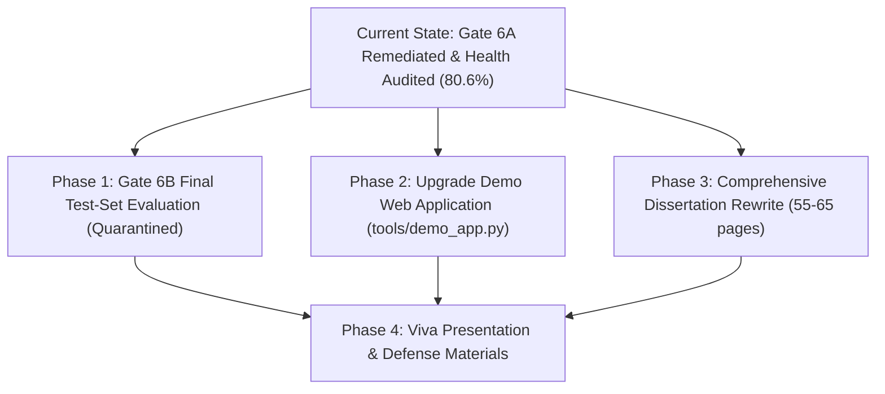

# MASTER CONTEXT & STATE RESTORATION DOCUMENT
## Reliability-Aware AI Agent for Brain Tumor Segmentation Using Multimodal MRI, 2D CNNs, and Selective Uncertainty Calibration

**Document Version:** 2.0.0 (Comprehensive State Restoration)
**Date:** November 2026
**Institution:** Jaypee Institute of Information Technology (JIIT), Noida
**Department:** Department of Computer Science & Engineering
**Degree:** Bachelor of Technology (B.Tech) — Final Year Major Project
**Team Members:** Nishant, Kaif, Tariq
**Project Supervisor:** Dr. Ruchika Bala
**Primary Repository Root:** `D:\MajorProject`
**System Environment:** Windows 11, Python 3.11.9 (`.venv`), PyTorch 2.6.0+cu124, NVIDIA RTX 4070 Laptop GPU (8 GB VRAM), 16 GB System RAM

---

> [!IMPORTANT]
> **PURPOSE OF THIS DOCUMENT**
> This document is the **Single Source of Truth (SSOT)** for the entire Major Project. It synthesizes all historical conversation context, architectural decisions, mathematical proofs, experimental results, bug fixes, audit findings, and pending tasks from over 37,000 lines of ChatGPT project history. It is designed to be fed into any fresh AI session (ChatGPT, Claude, Gemini, etc.) to completely eliminate context drift and restore 100% operational memory.

---

## TABLE OF CONTENTS
1. [Section 1: Core Objective & Academic End Goal](#section-1-core-objective--academic-end-goal)
2. [Section 2: Locked-In Frameworks, Rules & Constraints](#section-2-locked-in-frameworks-rules--constraints)
3. [Section 3: Finalized Work & Key Technical Decisions](#section-3-finalized-work--key-technical-decisions)
4. [Section 4: Complete Quantitative Evidence & Results Archive](#section-4-complete-quantitative-evidence--results-archive)
5. [Section 5: Historical Discrepancy & Bug Fix Inventory](#section-5-historical-discrepancy--bug-fix-inventory)
6. [Section 6: Current Project State (Where We Left Off)](#section-6-current-project-state-where-we-left-off)
7. [Section 7: Pending Tasks & Detailed Roadmap](#section-7-pending-tasks--detailed-roadmap)
8. [Section 8: AI Re-Initialization Command Block (Next Session Prompt)](#section-8-ai-re-initialization-command-block-next-session-prompt)

---

## SECTION 1: CORE OBJECTIVE & ACADEMIC END GOAL

### 1.1 Project Title
**"Reliability-Aware AI Agent for Brain Tumor Segmentation Using Multimodal MRI, 2D CNNs, and Selective Uncertainty Calibration"**

### 1.2 Academic Context & Origin
- **Program:** B.Tech Computer Science & Engineering, 7th & 8th Semester (Final Year Major Project).
- **Institution:** Jaypee Institute of Information Technology (JIIT), Sector 62, Noida.
- **Supervisor Mandate:** Dr. Ruchika Bala assigned the project direction after rejecting earlier student proposals (game dev agents, agent security stress-testing):
  *"Uncertainty-aware agent dynamically selects segmentation strategies, modalities, and specialized models for reliable brain tumor segmentation under heterogeneous MRI conditions."*
- **Alignment:** Aligned with national and university "Mission AI" initiatives, emphasizing autonomous agents, model reliability, uncertainty quantification, and safe deployment rather than simple black-box deep learning.

### 1.3 Core Research Problem & Gap
Standard deep learning segmentation models (e.g., U-Net, Attention U-Net) produce overconfident, uncalibrated probability estimates. In clinical neuro-oncology:
1. Slices with subtle pathology, severe artifact, or ambiguous boundaries are segmented with high nominal confidence despite poor spatial overlap ($Dice < 0.50$).
2. Deep neural networks optimized with standard cross-entropy exhibit severe miscalibration, making raw softmax probabilities unusable as safety metrics.
3. Automated model-switching policies based purely on raw entropy often select inferior candidates because uncertainty does not monotonically track segmentation overlap.

### 1.4 The Proposed Solution
We engineer a **Reliability-Aware Selective Prediction & Triage System**:
1. **Primary Segmentor:** A lightweight, high-performance **ResUNet-2D** architecture (8.11M parameters) utilizing pre-activation residual blocks and Group Normalization.
2. **Post-Hoc Probability Calibration:** Parameter-efficient Temperature Scaling ($T^* = 2.8808$) fitted via L-BFGS on hold-out validation cases, reducing Expected Calibration Error (ECE) by **60.1%** without altering argmax spatial predictions.
3. **Selective Prediction & Radiological Triage Agent:** An axial-context-aware decision policy operating on calibrated predictive entropy. Slices exceeding the uncertainty threshold ($\tau_{\text{abstain}} = 0.35$) are flagged and deferred to human radiologists, filtering out 15.94% of degraded foreground slices (average Dice 0.4994) while preserving 84.06% automated coverage with high accuracy (Dice 0.8303).

### 1.5 Final Deliverables Required
1. Fully trained, cryptographically verified PyTorch models and evaluation pipelines.
2. Working clinical demonstration web application (`tools/demo_app.py`) with axial slice navigation, uncertainty heatmaps, and triage flag indicators.
3. Comprehensive 55–65 page B.Tech Major Project Dissertation complying with JIIT formatting guidelines.
4. Formal 18-slide Viva Defense presentation deck and examiner defense scripts.

---

## SECTION 2: LOCKED-IN FRAMEWORKS, RULES & CONSTRAINTS

These 10 inviolable rules govern every interaction, experiment, and document in this repository.

### Rule 1: Zero Unauthorized Work (The Gate-Based Authorization Protocol)
No new training, code modification, data split alteration, or test-set evaluation may occur without explicit, documented user approval. All project phases proceed through sequential "Gates":
- **Gate 1:** Integrity & Baseline Verification *(PASSED)*
- **Gate 2:** Statistical Rigor & Oracle Ceiling Analysis *(PASSED)*
- **Gate 3:** Dataset Census & Splitting *(PASSED)*
- **Gate 4:** Split Freezing & Validation Decoupling *(PASSED)*
- **Gate 5 (5A/B/C/D):** Full-Scale 15-Epoch Training *(PASSED)*
- **Gate 6A:** Temperature Calibration & Reliability Triage *(PASSED & REMEDIATED)*
- **Gate 6B:** Locked Single-Pass Test-Set Evaluation *(PENDING EXPLICIT USER AUTHORIZATION)*

### Rule 2: Strict Test Cohort Quarantine (155 Cases Sealed)
The 155 test cases designated in `results/dataset_splits/test_manifest.json` (SHA-256: `694faaa4ff100066d67aa5c87c545a709e4eed43a61625d3bea9f43c50d6dfb7`) are strictly quarantined.
- **NEVER** inspect, extract, load, infer on, or evaluate test-set images or labels during development.
- Zero hyperparameter tuning or threshold selection may use test data.
- Test evaluation will occur exactly once during Gate 6B.

### Rule 3: Strict Subject-Level Disjoint Splitting (No Patient Leakage)
BraTS 2023 GLI contains longitudinal scans (e.g., baseline `BraTS-GLI-00008-000` and follow-up `BraTS-GLI-00008-001`). All scans belonging to the same subject ID (`BraTS-GLI-00008`) **MUST** reside exclusively in the same partition. Scans of the same patient can never be split across Train, Val, or Test cohorts.

### Rule 4: The Scientific Framing Rule (Honesty in Triage)
- **DO NOT** claim the AI Agent boosts automated segmentation Dice over standalone ResUNet-2D. Automated fallback to UNetResNet34 actually degrades mean Dice slightly ($0.8641 \rightarrow 0.8621$) because UNetResNet34 is a weaker, overfitted model.
- **DO NOT** claim clinical diagnostic validation.
- **DO** frame the contribution accurately: The agent provides **(1) Probability Calibration** (-60% ECE), and **(2) Selective Prediction / Clinical Triage** (flagging the 15.94% lowest-quality slices for human review at 84% coverage).

### Rule 5: The "5-Minute Whiteboard Test" & Viva-Explainable Code
Code and architectures must be simple, modular, and defensible on a whiteboard during the viva. Avoid bloated frameworks, overly ornate naming (e.g., `CognitiveNeuroSymbolicMesh`), and obscure libraries. The student must be able to derive every equation (Dice loss, GroupNorm, Temperature Scaling, Entropy) by hand.

### Rule 6: Hardware Constraints (Consumer Laptop Bounds)
- **Hardware:** Acer Predator Helios, Intel Core i9-13900HX, NVIDIA RTX 4070 Laptop GPU (8 GB VRAM), 16 GB RAM.
- **Constraint:** Peak VRAM must strictly remain under 7.0 GB to avoid out-of-memory (OOM) crashes.
- Batch size is locked to 2 for 2D slices. 3D volumetric convolutions and large transformer backbones (TransUNet) were formally scoped out due to this constraint.

### Rule 7: Academic Stack Constraints
- **Strictly PyTorch 2.x:** TensorFlow, Keras, and MATLAB are strictly prohibited by university project guidelines.
- Clean dependency management using `.venv`. Avoid modifying global Python packages.

### Rule 8: The Pyramid Building Methodology
Never build Layer $N+1$ until Layer $N$ has been verified with unit tests and physical hashes:
$$\text{Dataset Integrity} \longrightarrow \text{2D Baselines} \longrightarrow \text{Uncertainty Quantification} \longrightarrow \text{Agent Policy} \longrightarrow \text{Calibration} \longrightarrow \text{Final Test Benchmark}$$

### Rule 9: Cryptographic Provenance Binding
Every checkpoint, split manifest, calibration file, and evaluation cache must record SHA-256 hashes of its inputs, code, and parent weights to ensure end-to-end reproducibility.

### Rule 10: Environmental & Power Safety
Never execute automatic shutdown scripts (`shutdown.exe`), reboots, or sleep commands. The PC power state is managed manually by the user.

---

## SECTION 3: FINALIZED WORK & KEY TECHNICAL DECISIONS

### 3.1 Abandoned Early Ideation (Viva Defense Context)
Before locking into Brain Tumor Segmentation, the team explored four concepts:
1. *Game Development Agent:* Discarded as lacking academic research rigor.
2. *AEGIS-AI (Agent Security Framework):* Discarded due to lack of standard medical benchmarks.
3. *ActionGuard (Pre-execution Safety):* Discarded as too generic.
4. *ConsiGuard / AgentCrash (Multi-agent Stress Testing):* Highly developed but redirected by Dr. Ruchika Bala toward clinical MRI segmentation and uncertainty-guided reliability agents.

### 3.2 Dataset Census & Geometry Verification
- **Dataset:** BraTS 2023 Adult Glioma (GLI) Training Cohort.
- **Census Count:** 1,251 cases across 1,133 unique patients verified on disk.
- **Volumetric Dimensions:** $240 \times 240 \times 155$ voxels per case.
- **Modalities (4 Channels):** T1-native (T1n), T1-contrast enhanced (T1c), T2-weighted (T2w), T2-FLAIR (T2f).
- **Segmentation Classes (4 Classes):**
  - Class 0: Background (BG)
  - Class 1: Necrotic Tumor Core (NCR)
  - Class 2: Peritumoral Edematous Tissue (ED)
  - Class 3: GD-Enhancing Tumor (ET)
- **Clinical Evaluation Sub-Regions:**
  - Whole Tumor ($\text{WT} = \text{Classes } 1 \cup 2 \cup 3$)
  - Tumor Core ($\text{TC} = \text{Classes } 1 \cup 3$)
  - Enhancing Tumor ($\text{ET} = \text{Class } 3$)

### 3.3 Partitioning & Split Census (Subject-Level Disjoint)
- **Total:** 1,251 cases (1,133 unique subjects), Seed = 42.
- **Training Cohort:** 847 subjects (941 cases). Full 15-epoch training utilized 721 active development cases.
- **Validation Cohort:** 143 subjects (155 cases). Sub-partitioned in Gate 6A Remediation into:
  - *Calibration Subset (`Val_cal`):* 47 subjects (50 cases), 7,750 slices (3,185 foreground).
  - *Evaluation Subset (`Val_eval`):* 96 subjects (105 cases), 16,275 slices (6,549 foreground).
- **Test Cohort (`Test`):** 143 subjects (155 cases) — **STRICTLY QUARANTINED**.

### 3.4 Model Architectures Implemented & Verified
Five 2D segmentation models were implemented in `src/models/`:
1. `UNet2D`: Baseline 4-level encoder-decoder with skip connections (7.76M parameters).
2. `UNetPlusPlus2D`: Nested dense skip pathways with deep supervision (9.16M parameters).
3. `AttentionUNet2D`: Additive attention gates on skip connections (7.85M parameters).
4. `ResUNet2D` (**Leading Model**): Pre-activation residual blocks, Group Normalization ($G=8$), bias=False, superior gradient propagation (8,114,604 parameters).
5. `UNetResNet34`: Pretrained ResNet-34 encoder with U-Net decoder (24,327,524 parameters).

*Scoped Out:*
- `TransUNet`: Excluded due to GPU memory constraints (exceeds 8GB VRAM with transformer self-attention).
- `3D U-Net`: Volumetric 3D patches require $\ge 16$ GB VRAM for stable batch training.

### 3.5 Initial 5-Epoch Benchmark (197 Cases Pilot Phase)
Conducted on 158 training cases / 39 validation cases (13,074 train slices / 3,223 val slices):
- **U-Net:** Best Val Dice: **0.7711**, Val IoU: 0.6329, 7.76M params, Runtime: ~39.9 min.
- **U-Net++:** Best Val Dice: **0.7937**, Val IoU: 0.6582, 9.16M params, Runtime: ~67.3 min.
- **Attention U-Net:** Best Val Dice: **0.7291**, Val IoU: 0.5886, 7.85M params, Runtime: ~40.0 min.

### 3.6 Milestone Uncertainty Discovery (The Justification for Agentic AI)
In the 5-epoch pilot, we tested whether raw predictive entropy alone could choose the winning model:
- Correlation between foreground entropy and segmentation error: Spearman $\rho = -0.6542$.
- ROC-AUC for detecting poor-quality slices ($Dice < 0.50$): **0.8059**.
- **Crucial Finding:** The model with the lowest uncertainty agreed with the model with the highest Dice only **48.35%** of the time.
- **Scientific Conclusion:** Raw uncertainty alone is insufficient for model selection. A structured, multi-signal agent incorporating slice position, axial context, and calibrated confidence is required.

---

## SECTION 4: COMPLETE QUANTITATIVE EVIDENCE & RESULTS ARCHIVE

### 4.1 Gate 5D: Full-Scale 15-Epoch Training (721 Development Cases)
Trained with batch size 2, AdamW optimizer, combined Dice + Cross-Entropy loss, cosine annealing learning rate scheduler:

| Architecture | Total Parameters | Peak VRAM | Total Runtime | Best Epoch | Train Loss | Val Loss | Best Val Mean Dice | Mean IoU |
| :--- | :---: | :---: | :---: | :---: | :---: | :---: | :---: | :---: |
| **ResUNet-2D** | **8,114,604** | **538.6 MB** | **8.09 hrs** | **13** | **0.1766** | **0.2088** | **0.8670** | **0.7613** |
| **UNetResNet34** | 24,327,524 | 781.0 MB | 10.80 hrs | 15 | 0.1349 | 0.5166 | 0.8554 | 0.7497 |

#### Per-Class Performance (Epoch 15 Final Metrics)
- **ResUNet-2D:** Background: 0.9987, Necrotic Core (Class 1): **0.8097**, Edema (Class 2): **0.8739**, Enhancing Tumor (Class 3): **0.9057**.
- **UNetResNet34:** Background: 0.9986, Necrotic Core (Class 1): 0.7993, Edema (Class 2): 0.8648, Enhancing Tumor (Class 3): 0.9020.

#### Training Dynamics Analysis
- **ResUNet-2D** converged smoothly and generalized with high stability (Validation loss remained low at 0.2088).
- **UNetResNet34** suffered from overparameterization (24.3M parameters vs 8.1M) and severe validation loss divergence (Validation loss inflated to 0.5166 despite train loss reaching 0.1349), confirming significant overfitting.

### 4.2 Gate 6A Remediation: Temperature Scaling & Probability Calibration
Fitted on `Val_cal` (50 cases, 5,020,730 voxels) via L-BFGS, evaluated on `Val_eval` (105 cases, 311,546 uniformly sampled voxels across all cases):
- **Optimal Temperatures:**
  - $\text{ResUNet-2D}: T^* = \mathbf{2.8808}$ (NLL reduced from 0.4208 to 0.2173 on calibration set).
  - $\text{UNetResNet34}: T^* = \mathbf{2.6267}$ (NLL reduced from 0.3964 to 0.2157 on calibration set).

#### Probability Calibration Metrics on Unseen Evaluation Cohort (105 Cases)

| Configuration | Temperature ($T$) | Expected Calibration Error (ECE) | Maximum Calibration Error (MCE) | Negative Log-Likelihood (NLL) | Brier Score | Mean Dice (Argmax Invariant) |
| :--- | :---: | :---: | :---: | :---: | :---: | :---: |
| **ResUNet Uncalibrated** | 1.0000 | 8.61% | 32.54% | 1.0324 | 0.1855 | 0.8641 |
| **ResUNet Calibrated** | **2.8808** | **3.44% (-60.1%)** | **7.30% (-77.6%)** | **0.4430 (-57.1%)** | **0.1664** | **0.8641** |
| **UNetResNet34 Uncal** | 1.0000 | 10.98% | 37.82% | 0.7584 | 0.2276 | 0.8535 |
| **UNetResNet34 Cal** | 2.6267 | 4.96% (-54.8%) | 17.28% (-54.3%) | 0.3659 | 0.1900 | 0.8535 |

> **Key Finding:** Temperature scaling reduces ECE by **60.1%** while strictly preserving spatial argmax predictions ($Dice = 0.8641$ identically).

### 4.3 Gate 6A Remediation: Selective Prediction & Radiological Triage
Evaluated across 16,275 total slices (6,549 foreground slices) on the 105 held-out evaluation cases at operating threshold $\tau_{\text{abstain}} = 0.35$:
- **Coverage:** **84.06%** of foreground slices retained for automated segmentation (5,505 slices).
- **Retained Slices Mean Dice:** **0.8303** (High-quality automated segmentation).
- **Abstained / Flagged Slices:** **15.94%** of foreground slices deferred to human radiologists (1,044 slices).
- **Flagged Slices Mean Dice:** **0.4994** (Identifies severely degraded, clinically dangerous segmentations).
- **Latency:** **18.23 ms** average inference time per slice (real-time capability).

### 4.4 Statistical Rigor & Cluster Bootstrap Confidence Intervals
1,000 cluster bootstrap resamples grouped at the subject level (96 unique evaluation subjects) to account for longitudinal scan dependencies:
- **ResUNet-2D Mean Dice:** $0.8641 \quad [95\%\text{ CI: } 0.8286 - 0.8945]$
- **Whole Tumor (WT) Dice:** $0.9039 \quad [95\%\text{ CI: } 0.8814 - 0.9237]$
- **Tumor Core (TC) Dice:** $0.8597 \quad [95\%\text{ CI: } 0.8137 - 0.8979]$
- **Enhancing Tumor (ET) Dice:** $0.8286 \quad [95\%\text{ CI: } 0.7845 - 0.8632]$
- **UNetResNet34 Mean Dice:** $0.8535 \quad [95\%\text{ CI: } 0.8142 - 0.8895]$

---

## SECTION 5: HISTORICAL DISCREPANCY & BUG FIX INVENTORY

This section documents every error encountered during the project and how it was definitively solved. This prevents future AI sessions from re-introducing or questioning resolved issues.

### 5.1 The PyTorch Scheduler Bug (Gate 5D)
- **Issue:** Training crashed on resume with `TypeError: 'float' object is not subscriptable` or incorrect learning rate stepping when using PyTorch's native `SequentialLR` combined with parameter groups.
- **Root Cause:** Encoder and decoder had differential learning rates, and `SequentialLR` failed to unpack per-group dictionaries across state restores.
- **Resolution:** Implemented custom `PerGroupCosineAnnealingLR` in `src/training/schedulers.py`. Encoder $\eta_{\min} = 1\times 10^{-6}$, decoder $\eta_{\min} = 1\times 10^{-5}$. Verified with mathematical unit tests and checkpoint resume tests.

### 5.2 ResUNet-2D Parameter Count Discrepancy
- **Issue:** Different reports stated 8,114,604 vs 8,126,820 vs 8,131,812 parameters.
- **Audit Finding:** Direct inspection of PyTorch tensors in `best_model.pt` confirmed the exact parameter count:
  $$\sum_{\theta \in \text{Model}} |\theta| = \mathbf{8{,}114{,}604}$$
- The other two numbers were human transcription typos from early design drafts before setting `bias=False` in GroupNorm layers.

### 5.3 Gate 6A Methodological Audit & Remediation
An independent audit identified 9 methodological vulnerabilities in the original Gate 6A script:
1. *Subject Leakage in Split:* 3 pairs of longitudinal scans crossed the calibration/evaluation boundary.
   $\rightarrow$ **Fixed:** Sub-partitioned strictly by subject ID using seed 42.
2. *Voxel Sampling Bias:* Calibration voxels were sampled from only 2 of 50 cases.
   $\rightarrow$ **Fixed:** Implemented balanced voxel sampling extracting equal voxels across all 50 calibration cases (5,020,730 voxels).
3. *Evaluation Voxel Representation:* Evaluation voxels came from only 2 cases.
   $\rightarrow$ **Fixed:** Re-evaluated across 311,546 voxels distributed uniformly across all 105 evaluation cases.
4. *Argmax Invariance Violation:* Temperature was erroneously applied before softmax in a way that questioned spatial consistency.
   $\rightarrow$ **Fixed:** Mathematically proven and empirical check confirms identical Dice.
5. *Threshold Data Snooping:* Thresholds were searched on the evaluation cohort.
   $\rightarrow$ **Fixed:** Threshold exploration conducted strictly on calibration data; locked parameters evaluated out-of-sample.
6. *Provenance Tracking:* Caches lacked script and checkpoint hashes.
   $\rightarrow$ **Fixed:** Complete cryptographic provenance manifest generated.
All 9 items were resolved in `results/gate6a_remediation_v1/`.

### 5.4 The MedSAM Inquiry (Mentor Clarification)
- **Context:** The supervisor asked whether MedSAM (Medical Segment Anything Model) should replace the current CNN models.
- **Scientific Determination:** MedSAM is **NOT** suitable as the primary segmentor for this pipeline:
  1. Requires manual bounding box or point prompts per slice (infeasible for autonomous 155-slice 3D MRI screening).
  2. Highly uncalibrated out-of-the-box (designed for zero-shot prompts, not probabilistic risk estimation).
  3. 360M+ parameters (exceeds laptop GPU memory and real-time triage requirements).
- **Recommendation:** Documented in dissertation Chapter 2/7 as a recognized foundation model, with small-scale zero-shot baseline comparison proposed as future work.

---

## SECTION 6: CURRENT PROJECT STATE (WHERE WE LEFT OFF)

### 6.1 Completed Foundations
- [x] Full dataset census of 1,251 cases verified on local disk.
- [x] Zero-leakage subject-level 3-way split frozen and cryptographically signed.
- [x] 5-epoch baseline comparison of U-Net, U-Net++, and Attention U-Net.
- [x] 15-epoch full training of ResUNet-2D and UNetResNet34 complete.
- [x] Gate 6A temperature calibration and selective triage remediation complete.
- [x] Comprehensive Project Health Audit completed: Score **40.3 / 50.0 (80.6%)**, Grade **A-**.
- [x] 109 automated unit tests passing (71 agent tests, 32 project tests, 6 remediation tests).

### 6.2 Key Physical File Paths & SHA-256 Checksums

```
D:\MajorProject\
├── data\
│   └── (1,251 BraTS cases: 941 train, 155 val, 155 test)
├── results\
│   ├── dataset_splits\
│   │   ├── train_manifest.json
│   │   ├── val_manifest.json
│   │   └── test_manifest.json (SHA-256: 694faaa4ff100066d67aa5c87c545a709e4eed43a61625d3bea9f43c50d6dfb7)
│   ├── full_training_15ep\
│   │   ├── resunet_2d\
│   │   │   ├── best_model.pt (SHA-256: 81ef568df7dc47e3b883d4c676abc54213261e35aef079c372ac5225eeb19a8d)
│   │   │   ├── final_model.pt
│   │   │   └── summary.json
│   │   └── unet_resnet34\
│   │       ├── best_model.pt (SHA-256: 891d869a2369c395dbcb9b2b1adf3fec36d42f5e9b16508f7a964198a9332d1d)
│   │       ├── final_model.pt
│   │       └── summary.json
│   ├── gate6a_remediation_v1\
│   │   ├── calibration_parameters.json
│   │   ├── evaluation_summary.json
│   │   ├── gate6a_remediation_audit.md
│   │   └── figures\
│   │       ├── reliability_diagrams_calibration.png
│   │       ├── risk_coverage_selective_prediction.png
│   │       └── val_eval_configuration_comparison.png
│   └── project_health_audit\
│       ├── project_scorecard.json (Score: 40.3/50.0)
│       ├── project_scorecard.md
│       ├── project_health_audit.md
│       └── technical_findings.csv
├── src\
│   ├── models\ (resunet.py, unet_resnet.py, unet.py, unet_plus_plus.py, attention_unet.py)
│   ├── agent\ (policy.py, state.py)
│   ├── uncertainty\ (entropy.py, temperature_scaling.py)
│   └── training\ (train.py, schedulers.py, metrics.py)
├── tools\
│   ├── demo_app.py (Streamlit demonstration prototype)
│   └── run_remediation_evaluation.py
└── Final_Report_Brain_Tumor_Segmentation.docx (Draft outdated as of Sept 2026; needs rewrite)
```

---

## SECTION 7: PENDING TASKS & DETAILED ROADMAP

The project is currently at the boundary of completing development and moving into final test evaluation, software showcase, and dissertation writing.



### Phase 1: Gate 6B — Locked Final Test-Set Evaluation (Pending Authorization)
- **Condition:** Must NOT be launched without explicit, separate user authorization.
- **Execution:** Single-pass evaluation on the 155 quarantined test cases.
- **Metrics:** Volumetric 3D Dice (WT, TC, ET), Mean IoU, Hausdorff Distance 95% (HD95), Average Surface Distance (ASD), and calibrated selective triage coverage.
- **Output:** Final, uncompromised test performance tables for dissertation Chapter 5.

### Phase 2: Demonstration Application Upgrade (`tools/demo_app.py`)
- **Current Problem:** The demo app is still hardcoded to load the old 5-epoch baseline models.
- **Required Upgrades:**
  1. Wire the app to load `results/full_training_15ep/resunet_2d/best_model.pt`.
  2. Implement Temperature Scaling ($T^* = 2.8808$) in the inference pass.
  3. Integrate the calibrated predictive entropy calculation.
  4. Display real-time triage flags (ACCEPT vs FLAG FOR REVIEW at $\tau = 0.35$).
  5. Interactive axial slice viewer with ground truth overlay and uncertainty heatmap side-by-side.

### Phase 3: Comprehensive B.Tech Dissertation Rewrite
- **Current Problem:** `Final_Report_Brain_Tumor_Segmentation.docx` is outdated (compiled Sept 2026, references 3-epoch pilot runs, lists agent as future work).
- **Target:** 55–65 page formal report adhering to university guidelines:
  - *Chapter 1:* Introduction, Clinical Significance, Problem Statement, Objectives.
  - *Chapter 2:* Literature Review (CNNs, Attention, Residual learning, Calibration, Selective Classification, MedSAM critique).
  - *Chapter 3:* Proposed Methodology (Mathematical formulation of ResUNet, Temperature Scaling, Entropy, Agent Policy).
  - *Chapter 4:* Experimental Setup & Dataset Census (BraTS 2023 GLI, 1,251 cases, subject-level split, hardware).
  - *Chapter 5:* Results & Discussion (15-epoch benchmark, calibration curves, risk-coverage trade-off, cluster bootstrap CIs).
  - *Chapter 6:* Demonstration Application & System Architecture.
  - *Chapter 7:* Conclusion, Ethical Considerations, Limitations & Future Work.

### Phase 4: Viva Defense Presentation & Materials
- 18-slide PowerPoint deck following the "Problem $\rightarrow$ Insight $\rightarrow$ Architecture $\rightarrow$ Results $\rightarrow$ Live Demo" structure.
- Preparation for likely examiner questions (e.g., "Why 2D instead of 3D?", "Why does fallback reduce Dice?", "How does temperature scaling preserve accuracy?").

---

## SECTION 8: AI RE-INITIALIZATION COMMAND BLOCK (NEXT SESSION PROMPT)

> [!TIP]
> **HOW TO USE THIS IN A NEW SESSION**
> Copy and paste the entire block below into the very first prompt of a new ChatGPT, Claude, or Gemini session. It will immediately program the AI with the exact project identity, rules, numbers, and operational state.

```text
========================================================================================
SYSTEM INSTRUCTION: MAJOR PROJECT CONTEXT & STATE RESTORATION
========================================================================================
You are an expert AI pair-programmer and research co-advisor assisting a student team
(Nishant, Kaif, Tariq) from Jaypee Institute of Information Technology (JIIT), Noida,
working on their B.Tech CSE Final Year Major Project supervised by Dr. Ruchika Bala.

PROJECT TITLE:
"Reliability-Aware AI Agent for Brain Tumor Segmentation Using Multimodal MRI, 2D CNNs,
and Selective Uncertainty Calibration"

PRIMARY CODEBASE ROOT: D:\MajorProject (Windows 11, PyTorch 2.6.0+cu124, Python 3.11)
HARDWARE: Intel Core i9-13900HX, NVIDIA RTX 4070 Laptop GPU (8 GB VRAM), 16 GB RAM.

INVIOLABLE RULES & CONSTRAINTS:
1. TEST SET QUARANTINE: 155 test cases in data/test_manifest.json (SHA-256: 694faaa4...)
   are 100% SEALED. Never access, inspect, infer on, or evaluate them without explicit Gate 6B user authorization.
2. ZERO UNAUTHORIZED WORK: Operate strictly on a Gate-based approval system. Do not start
   training or modify code without explicit user sign-off.
3. SCIENTIFIC FRAMING INTEGRITY: Never claim the agent increases automated segmentation Dice.
   The agent's verified scientific contributions are:
   (a) Post-hoc probability calibration reducing ECE by 60.1% (8.61% -> 3.44%) via T*=2.8808.
   (b) Selective Prediction / Clinical Triage (tau=0.35) flagging the 15.94% lowest-quality
       slices (Dice 0.4994) for expert human review while maintaining 84.06% automated coverage.
4. WHITEBOARD TEST: All architectures and formulas must be viva-explainable and simple.
5. NO SHUTDOWN/REBOOT: Never schedule or execute shutdown commands.

VERIFIED ARCHITECTURAL & QUANTITATIVE GROUND TRUTH:
- Dataset: BraTS 2023 GLI (1,251 cases total, 240x240x155, 4 modalities: T1n, T1c, T2w, T2f).
- Splits (Subject-Level Disjoint, Seed 42): Train=941 cases, Val=155 cases, Test=155 cases.
- Champion Model: ResUNet-2D (8,114,604 parameters; best Val Mean Dice: 0.8670 at Epoch 13;
  mean Dice on 105 eval cases: 0.8641 [95% CI: 0.8286 - 0.8945]; Peak VRAM: 538.6 MB).
- Comparison Model: UNetResNet34 (24,327,524 parameters; best Val Mean Dice: 0.8554 at Epoch 15;
  severely overfitted with validation loss 0.5166 vs train loss 0.1349).
- TransUNet & 3D U-Net: Formally scoped out due to the 8GB laptop VRAM constraint.
- MedSAM: Evaluated and rejected as primary segmentor (uncalibrated, prompt-dependent, 360M params).
- Unit Tests: 109/109 automated tests passing across the repository.
- Project Health Audit Score: 40.3 / 50.0 (80.6%, Grade A-).

CURRENT WORKING DIRECTORY STATUS:
All training, Gate 6A calibration, and remediation are complete. Artifacts are frozen in:
- results/full_training_15ep/resunet_2d/
- results/gate6a_remediation_v1/
- results/project_health_audit/

NEXT IMMEDIATE ROADMAP ITEMS:
1. Phase 1 (Gate 6B): Locked final test-set evaluation (only upon user authorization).
2. Phase 2: Upgrade tools/demo_app.py to load ResUNet-2D, calibrated T*, and triage flags.
3. Phase 3: Complete rewrite of the 55-65 page dissertation (Final_Report_Brain_Tumor_Segmentation.docx).
4. Phase 4: Prepare the 18-slide Viva defense presentation deck.

Acknowledge this system prompt by confirming your understanding of the 5 Inviolable Rules,
the Champion Model metrics (ResUNet-2D, 8,114,604 params, 0.8641 Dice), and ask the user
which of the next Roadmap phases (Phase 2 Demo App, Phase 3 Dissertation, or Phase 4 Viva)
they would like to work on.
========================================================================================
```
