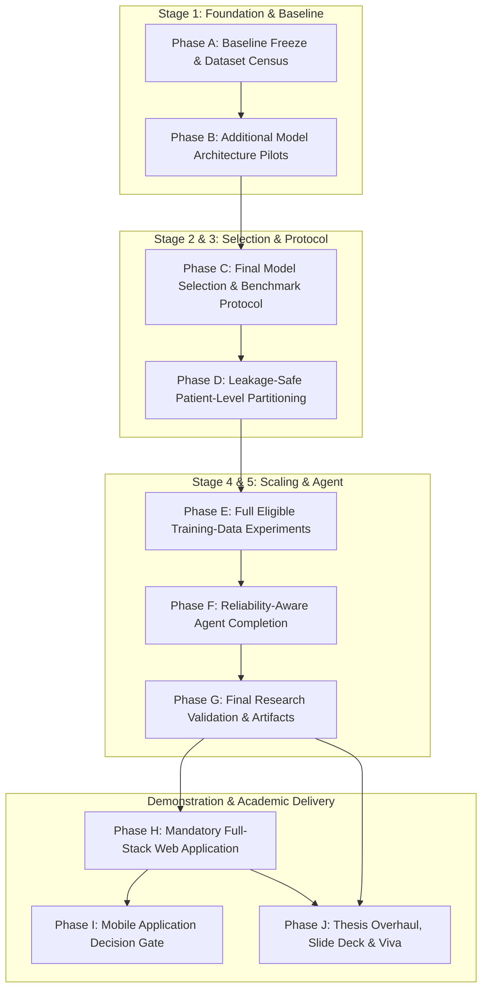

# Master Project Roadmap: Brain Tumor Segmentation Using Uncertainty and Towards a Reliability-Aware AI Agent

**Document:** Authoritative Master Project Roadmap & Comprehensive Execution Plan
**Location:** `D:\MajorProject\docs\historical\MASTER_PROJECT_ROADMAP.md`
**Project Title:** Brain Tumor Segmentation Using Uncertainty and Towards a Reliability-Aware AI Agent
**Academic Degree:** B.Tech Computer Science & Engineering (Major Project)
**Host Department:** Department of Computer Science & Engineering and Information Technology, JIIT Noida
**Current Date:** October 26, 2026
**Document Status:** Reconciled Master Document (Targeted Planning Corrections Applied)
**Target Submission Platform:** Windows 11, Python 3.11.9 (`.venv`), PyTorch 2.11.0+cu128, NVIDIA GeForce RTX 4070 Laptop GPU (8 GB VRAM, 75.15 GB free disk)

---

## 1. Executive Summary & Authoritative Baseline State

### 1.1 Executive Summary
Automated brain tumor segmentation in multi-parametric magnetic resonance imaging (mpMRI) using standard 2D convolutional neural networks (CNNs) faces a fundamental clinical trade-off: high-capacity models (e.g., U-Net++) achieve strong overall overlap on large central slices but suffer from boundary false negatives (complete miss rates exceeding 12% on low-contrast lesions). Conversely, standard architectures (e.g., standard U-Net) exhibit high boundary sensitivity but produce elevated false-alarm clusters on healthy brain tissue.

Rather than relying blindly on full 3D volumetric convolutions—which demand severe downsampling or small patch-slicing to fit within 8 GB laptop VRAM—this project pioneers a **spatial-continuity and reliability-aware AI agent**. In the initial research prototype, the agent monitors primary U-Net++ predictions, interrogates neighboring axial slices ($z \pm k$) upon encountering an empty candidate mask, and activates a specialized fallback architecture (Attention U-Net) only when spatial context confirms lesion continuity.

Following forensic project audits, consistency reviews, and stakeholder reconciliation, the project scope has been elevated from an exploratory 158-case research pilot to a **comprehensive, production-grade clinical engineering project**. This master roadmap establishes mandatory deliverables:
1. **Architectural Portfolio Expansion (Phase B):** ResUNet-2D, U-Net with ResNet encoder, TransUNet (CNN-Transformer hybrid), and a documented 3D U-Net feasibility assessment.
2. **Defensible Final Model Selection & Benchmarking (Phase C):** Multi-metric evaluation (WT, TC, ET, macro/micro Dice, IoU, sensitivity, specificity, complete misses, false-alarm rate, latency, memory) and inferential statistics (Wilcoxon tests, cluster bootstrap CIs) without relying solely on aggregate Dice or artificial performance guarantees.
3. **Leakage-Safe Patient-Level Partitioning (Phase D):** Creation of a frozen, 3-way partition (Train / Val / Held-Out Pristine Test) across all verified eligible cases in the BraTS 2023 GLI training archive.
4. **Full-Scale Eligible Training-Data Experiments (Phase E):** Scaling model training across all eligible cases in the training split with staged GPU resource management and explicit review gates.
5. **Reliability-Aware Agent Completion (Phase F):** Expanding the agent beyond 2-model context fallback to incorporate predictive uncertainty, whole-brain background ambiguity, and multi-model arbitration.
6. **Mandatory Full-Stack Web Application (Phase H):** A decoupled clinical demonstration system featuring a React 18 + Vite + TypeScript frontend, FastAPI backend, and PyTorch model serving.
7. **Conditional Mobile Application Decision (Phase I):** Formal evaluation of mobile demonstration requirements and decision gate based on actual evaluation criteria.
8. **Academic Thesis, Presentation & Viva Readiness (Phase J):** Comprehensive academic dissertation re-compilation, publication-grade figures, presentation slide deck, and defense rehearsal.

---

### 1.2 Forensic Inventory of Current Verified State

| Artifact Category | Verified Current Reality | Verified Evidence & Location | Status |
| :--- | :--- | :--- | :--- |
| **Extracted Raw Dataset** | 198 folders in `data/raw/` (2.07 GB); exactly 197 valid complete cases. Exactly 1 incomplete directory on disk: `BraTS-GLI-00646-001` (missing `t1c.nii.gz` and `t2w.nii.gz`). Partitioned into 158 train and 39 validation cases. | `data/raw/`, `src/data/dataset.py`<br>`README.md#L86` | Complete Baseline |
| **Archived Case Census** | `BraTS-GLI-00646-001` has all 5 files in the root ZIP archive; its disk incompleteness was due to interrupted extraction. `BraTS-GLI-01438-000` is complete on disk and archive, and is an active case in the 158-case train split. | Zip header verification & `results/input_condition/case_input_features.csv#L197` | Verified Reality |
| **Full Archive Datasets** | `ASNR-MICCAI-BraTS2023-GLI-Challenge-TrainingData.zip` (12.27 GiB, 1,251 case directories; 1,053 uncompressed cases available).<br>`ASNR-MICCAI-BraTS2023-GLI-Challenge-ValidationData.zip` (2.20 GiB, 219 cases, **0 ground-truth masks**; blind challenge evaluation set). | Direct zip headers & file inspection | Verified On Disk |
| **Storage Availability** | Drive D has **75.15 GB free disk space**. Extracted raw data averages ~10.7 MB/case. | Windows OS Volume Query | `[MEASURED]` |
| **Hardware Environment** | Windows 11, Python 3.11.9 (`.venv`), PyTorch 2.11.0+cu128, CUDA 12.8, NVIDIA GeForce RTX 4070 Laptop GPU (8 GB VRAM, ~140W TGP). | PyTorch & CUDA device query | Verified Active |
| **Trained Baseline Models** | Three 2D CNN models trained for 5 epochs on 158 cases (batch size 16, `DiceBCELoss`):<br>1. Standard U-Net (7.76M params, Val Dice 0.7711, Runtime: 39.9m `[MEASURED]`)<br>2. U-Net++ (9.16M params, Val Dice 0.7937, Runtime: 67.3m `[MEASURED]`)<br>3. Attention U-Net (7.85M params, Val Dice 0.7291, Runtime: 47.1m `[MEASURED]`) | `results/baseline_unet2d_5ep/best_model.pt`<br>`results/unetpp2d_5ep/best_model.pt`<br>`results/attention_unet2d_5ep/best_model.pt` | Verified Checkpoints |
| **Full-Volume Benchmark (M7)** | Six systems evaluated on all 155 slices across 39 validation cases (**6,045 unique slices/system; 36,270 total evaluation records**):<br>1. Standard U-Net (Dice: 0.7711, Miss Rate: 4.58%)<br>2. U-Net++ (Dice: 0.8078, Miss Rate: 12.53%)<br>3. Attention U-Net (Dice: 0.7291, Miss Rate: 4.81%)<br>4. Agent Baseline (Dice: 0.7963)<br>5. Agent Option A ($k=2$, canonical, Dice: 0.8116)<br>6. Agent Option B ($k=1$, aggressive, Dice: 0.8108) | `results/agent_evaluation/milestone7_full_volume/slice_evaluations.csv`<br>`evaluation_summary.json` | `[MEASURED]` Benchmark |
| **Option A vs. B Trade-off** | Strict nested monotonicity confirmed across 6,045 slices. Exactly 78 slices differ (1.29%): Option B recovers 27 boundary misses at the expense of 51 false-alarm slices on healthy brain tissue (1.89 : 1 penalty ratio). Option A is clinically superior. | `results/agent_evaluation/milestone7D_final_retrospective.md` | `[MEASURED]` Property |
| **Unit Test Suite** | 71 test cases fully passing in 2.4–3.5s across `src/agent/test_runner.py`, `test_full_volume.py`, `test_policy.py`, `test_models.py`, `test_state.py`. Peak test VRAM: ~350 MB. | `python -m unittest discover -s src/agent -p "test_*.py"` | Verified 100% Pass |
| **Phase 1 Integrity Gate** | Verified 71/71 tests passing; verified patient split disjointness: $158 \cap 39 = \emptyset$ (zero patient leakage). | Phase 1 Execution Logs | **Gate 1 Passed** |
| **Phase 2 Statistical Audit** | Paired Wilcoxon test confirmed Option A over U-Net++ ($W=0.0, p_{\text{adj}}=7.01 \times 10^{-7}$). 1,000-resample cluster bootstrap 95% CI: $[+0.0100, +0.0186]$. 2-model Oracle FG Dice: 0.6434; 3-model Oracle FG Dice: 0.6572. | `results/agent_evaluation/milestone7_full_volume/phase2_statistical_analysis.json` | **Gate 2 Passed** |
| **Phase 3 Showcase App** | Streamlit prototype created at `tools/demo_app.py` (27,086 bytes); 7/7 component smoke tests passed; verified headless launch on `http://localhost:8501`. | `tools/demo_app.py` | **Gate 3 Passed** |
| **Thesis Report Draft** | `Final_Report_Brain_Tumor_Segmentation.docx` built on 26 Sept 2026 prior to Milestones 1–7. Contains outdated 3-epoch numbers and describes the agent as "unimplemented future work". | `Final_Report_Brain_Tumor_Segmentation.docx` | Pending Overhaul |

> [!IMPORTANT]
> **Key Operational Reality:** The current operational agent is an axial-context fallback system. Predictive entropy ($H$) is analyzed offline ($\rho = -0.6542$ with Dice), but live M7 fallback routing operates strictly on primary empty-prediction status and spatial neighbor support (`high_uncertainty_threshold=None`). Active live multi-signal uncertainty gating is part of Phase F development.

---

## 2. Mandatory Staged-Development and Scaling Policy

The project enforces a strict **staged-development policy** (Stages 1 through 5). Full-scale training on the full dataset must not begin until smaller-scale architectural and validation gates have formally passed and user approval is granted.

```
┌───────────────────────────────────────────────────────────────────────────────────┐
│ STAGE 1: Current Baseline & Development Subset (158 Train / 39 Val Cases)         │
│ - Preserve baseline checkpoints; develop & benchmark new architectures on dev set  │
└─────────────────────────────────────────┬─────────────────────────────────────────┘
                                          │
                                          ▼
┌───────────────────────────────────────────────────────────────────────────────────┐
│ STAGE 2: System Readiness Gate                                                    │
│ - Verify training stability, loss convergence, metric consistency, and leakage    │
└─────────────────────────────────────────┬─────────────────────────────────────────┘
                                          │
                                          ▼
┌───────────────────────────────────────────────────────────────────────────────────┐
│ STAGE 3: Freeze Final Dataset Protocol (Census & 3-Way Partition)                 │
│ - Audit all archive cases; create Train (~70%) / Val (~15%) / Test (~15%) splits  │
│ - Quarantine pristine held-out test partition from all model/agent tuning         │
└─────────────────────────────────────────┬─────────────────────────────────────────┘
                                          │
                                          ▼
┌───────────────────────────────────────────────────────────────────────────────────┐
│ STAGE 4: Approved Full-Scale Training                                             │
│ - Blocked until Stages 1-3 pass, resource budget reviewed, & user approves        │
│ - Staged sequential execution; separate checkpoint directories; thermal safety    │
└─────────────────────────────────────────┬─────────────────────────────────────────┘
                                          │
                                          ▼
┌───────────────────────────────────────────────────────────────────────────────────┐
│ STAGE 5: Final-System Re-Evaluation & Full-Stack Integration                      │
│ - Re-evaluate models & agent on locked test set; generate final scientific tables  │
│ - Deliver full-stack React + FastAPI application and complete academic thesis     │
└───────────────────────────────────────────────────────────────────────────────────┘
```

### Detailed Stage Specifications:
- **Stage 1 — Current baseline and development subset:** Preserve existing checkpoints and the historical 158/39 baseline experiment. Develop and evaluate candidate architectures (ResUNet-2D, ResNet-encoder U-Net, TransUNet, 3D feasibility) strictly on the development subset. Verify preprocessing, training stability, and metric calculation consistency before requesting full-scale compute.
- **Stage 2 — System readiness gate:** Demonstrate that candidate models train and infer without numerical errors, comparisons use identical evaluation protocols, data leakage checks pass at the patient level, and known failure cases are documented.
- **Stage 3 — Freeze final dataset protocol:** Complete the full archive census. Verify file integrity and NIfTI geometry. Establish a reproducible patient-level 3-way partition: Training (~70%, ~875 cases `[ESTIMATE]`), Validation (~15%, ~188 cases `[ESTIMATE]`), and Held-Out Test (~15%, ~188 cases `[ESTIMATE]`). The historical 39 validation cases cannot be relabeled as pristine test data; the new test partition must remain strictly quarantined until locked evaluation.
- **Stage 4 — Approved full-scale training:** Train selected final models on the complete training partition. Preserve baseline checkpoints in separate directories (`experiments/baseline_*` vs. `experiments/full_scale_*`). Run sequential, staged jobs with explicit user approval for each run.
- **Stage 5 — Final-system re-evaluation:** Re-evaluate scaled models and the completed multi-signal agent on the locked test set. Produce verified benchmark tables and publishable figures. Transition frozen models to the full-stack web application.

---

## 3. Hardware, Compute, and Storage Feasibility Analysis

### 3.1 Hardware Constraints
- **GPU:** NVIDIA GeForce RTX 4070 Laptop GPU (8 GB GDDR6 VRAM, 140W TGP).
- **Host CPU & RAM:** Multi-core x86_64 CPU, 16+ GB RAM, Windows 11.
- **Disk Storage:** Drive D currently has **75.15 GB free space `[MEASURED]`**.

### 3.2 Storage Budgeting
- **Current Raw Data (`data/raw/` 198 folders):** 2.07 GB (`[MEASURED]`, ~10.7 MB/case).
- **Full Dataset Extraction (Up to 1,251 cases):** Extracting the remaining 1,053 cases from `ASNR-MICCAI-BraTS2023-GLI-Challenge-TrainingData.zip` (12.27 GiB) is projected to consume **~11.3 GB `[ESTIMATE]`**.
- **Total Raw Data on Disk:** **~13.4 GB `[ESTIMATE]`**, leaving **~61.75 GB free `[ESTIMATE]`**. Storage is completely sufficient.
- **Slice Cache Strategy:** Dynamically extracting 2D slices on-the-fly from NIfTI volumes using cached memory handles avoids writing 20+ GB of redundant PNG/NPY files to disk, saving wear and storage.
- **Checkpoints Storage:** ~35 MB per model $\times$ 5 architectures $\times$ 3 experiment runs $\approx$ 525 MB `[ESTIMATE]`.

### 3.3 GPU VRAM & Feasibility Limits (8 GB Boundary)
- **2D CNN Models (U-Net, U-Net++, Attn U-Net, ResUNet):** Native in-plane resolution $240 \times 240 \times 4$ float32. Batch size 16 consumes ~2.5 GB VRAM `[ESTIMATE]`; batch size 8 consumes ~1.6 GB VRAM `[ESTIMATE]`. Extremely safe with zero OOM risk.
- **TransUNet (CNN-Transformer Hybrid):** Vision Transformer bottleneck with 12 transformer layers. Batch size 8 is projected to consume **~3.8–4.5 GB VRAM `[ESTIMATE]`**. Feasible on an 8 GB GPU.
- **3D Volumetric U-Net Feasibility Assessment:**
  - A single full-volume 4-channel tensor ($240 \times 240 \times 155 \times 4$ float32) requires ~142.8 MB in raw storage.
  - In a standard 3D U-Net forward/backward pass with Adam optimizer states, feature activations scale with spatial volume ($O(D \cdot H \cdot W)$). Training a 3D U-Net on native full volumes requires **>18 GB VRAM `[ESTIMATE]`**, causing immediate CUDA OOM on an 8 GB laptop GPU.
  - *Feasibility Boundary:* A 3D U-Net can only run under two constrained regimes:
    1. Sub-volume patch cropping (e.g. $96 \times 96 \times 96$ or $128 \times 128 \times 128$) with sliding-window reassembly at inference time.
    2. Severe spatial downsampling (e.g. $128 \times 128 \times 128$ isotropic), which degrades high-frequency tumor boundary details.
  - Phase B will formally document this empirical constraint as part of the architecture trade-off report.

### 3.4 Training Runtime Estimates (5 Epochs Benchmark)
- **Measured Baseline Runtimes (158 cases, 5 epochs, batch size 16):**
  - Standard U-Net: **39.9 minutes `[MEASURED]`**
  - U-Net++: **67.3 minutes `[MEASURED]`**
  - Attention U-Net: **47.1 minutes `[MEASURED]`**
- **Projected Full Training Runtimes (~875 cases, $5.54\times$ data scaling `[ESTIMATE]`):**
  - Standard U-Net: **~3.7 hours `[ESTIMATE]`**
  - U-Net++: **~6.2 hours `[ESTIMATE]`**
  - Attention U-Net: **~4.3 hours `[ESTIMATE]`**
  - ResUNet-2D: **~4.1 hours `[ESTIMATE]`**
  - TransUNet-2D: **~5.5 hours `[ESTIMATE]`**
- **Total Compute Budget:** **~23.8 total GPU-hours `[ESTIMATE]`** across all 5 models. Executed strictly in sequential, staged overnight/background sessions with explicit user approval for each run.

---

## 4. Master Dependency Architecture



---

## 5. Phase-by-Phase Mandatory Execution Plan

### Phase A — Baseline Freeze, Repository Audit & Dataset Eligibility Census
- **Status:** **MANDATORY / PREREQUISITE**
- **Objective:** Inventory all existing models, checkpoints, configurations, and evaluation metrics; audit all cases in the 12.27 GiB training archive; verify archived files for `BraTS-GLI-00646-001` and document its eligibility decision separately without modifying `data/raw/` yet.
- **Tasks:**
  - `AUDIT-01`: Reconcile dataset census: 198 directories in `data/raw/`, 197 valid complete cases, 1 incomplete excluded directory on disk (`BraTS-GLI-00646-001`, missing `t1c` and `t2w`).
  - `AUDIT-02`: Document baseline 158/39 split checksums and confirm zero overlap ($158 \cap 39 = \emptyset$). Confirm `BraTS-GLI-01438-000` is an active training case.
  - `AUDIT-03`: Audit all 1,251 case directories in `ASNR-MICCAI-BraTS2023-GLI-Challenge-TrainingData.zip` and verify integrity of archive headers and file counts.
  - `AUDIT-04`: Establish the Experiment Ledger at `../../archive/project_roadmap/EXPERIMENT_PLAN.md` with explicit hardware and storage budgets.
- **Deliverables:** Verified baseline census report and frozen reference tables.
- **Gate 1:** Data integrity and baseline inventory approved by user.

---

### Phase B — Additional Segmentation Architectures (ResUNet, TransUNet, 3D Feasibility)
- **Status:** **MANDATORY PROJECT WORK**
- **Objective:** Broaden the model portfolio beyond the initial three CNNs by implementing and evaluating candidate architectures on the development split (158 cases).
- **Candidates to Evaluate:**
  1. **ResUNet-2D:** U-Net backbone with residual skip connections in encoder/decoder blocks to stabilize gradient flow and improve boundary sensitivity.
  2. **U-Net with ResNet-34 Encoder:** Pretrained/custom ResNet-34 feature extractor paired with standard transposed-convolution decoders.
  3. **TransUNet (CNN-Transformer Hybrid):** 2D CNN encoder extracting low-level feature maps, followed by a Vision Transformer (ViT) bottleneck capturing long-range global contextual dependencies, and a cascaded upsampler.
  4. **3D U-Net Feasibility Assessment:** Technical study documenting patch-based cropping ($96 \times 96 \times 96$) vs. isotropic downsampling, detailing VRAM consumption, memory bandwidth, and sliding-window reconstruction latency on the 8 GB RTX 4070.
- **Execution Protocol:** 5-epoch pilot runs on the 158-case development split using matching hyperparameters (batch size 16 or 8, `DiceBCELoss`, AdamW, lr=0.001).
- **Acceptance Criteria:** Candidate architectures pass unit tests, achieve stable loss convergence, and generate valid probability maps without numerical divergence.
- **Gate 2:** Additional-model pilot plan approved by user before launching training runs.

---

### Phase C — Final Model Selection and Multi-Metric Benchmarking Protocol
- **Status:** **MANDATORY PROJECT WORK**
- **Objective:** Perform a rigorous, multi-faceted comparison between baseline models (U-Net, U-Net++, Attention U-Net) and Phase B candidates on the development validation set (39 cases).
- **Evaluation Criteria (Beyond Single-Metric Aggregate Dice):**
  - Whole Tumor (WT), Tumor Core (TC), and Enhancing Tumor (ET) Dice / IoU.
  - Macro Slice Dice vs. Global Micro Voxel Dice.
  - Boundary Miss Rate: Proportion of tumor-bearing slices with completely empty predictions ($\hat{Y} = \emptyset$).
  - False Alarm Rate: Proportion of healthy brain slices with false positive predictions ($\hat{Y} > 0$).
  - Computational Cost: Parameter count, floating-point operations (FLOPs), per-slice inference latency (ms), peak GPU memory.
  - Inferential Statistics: Paired Wilcoxon signed-rank tests and 95% bootstrap confidence intervals across patient volumes.
  - Multi-Criteria Pareto Analysis: Accuracy vs. latency vs. boundary recall trade-offs.
- **Deliverables:** Multi-criteria decision matrix and frozen portfolio selection (Primary Model, Secondary Boundary Specialist, Fallback Arbitrator).
- **Gate 3:** Candidate models evaluated and final portfolio formally selected and frozen.

---

### Phase D — Leakage-Safe Patient-Level Partitioning Protocol
- **Status:** **MANDATORY BEFORE FULL-SCALE TRAINING**
- **Objective:** Establish a permanent, leakage-free 3-way partition across all verified eligible cases in the BraTS 2023 GLI training archive.
- **Partitioning Requirements:**
  - **Training Partition (~70%, ~875 cases `[ESTIMATE]`):** Exclusively utilized for gradient optimization of the final model portfolio.
  - **Validation Partition (~15%, ~188 cases `[ESTIMATE]`):** Utilized for hyperparameter tuning, convergence monitoring, and agent threshold calibration.
  - **Pristine Test Partition (~15%, ~188 cases `[ESTIMATE]`):** Strictly quarantined and untouched during all model training, threshold tuning, and agent design. Evaluated exactly once at project completion.
  - **Integrity Rule:** Slices from the same patient must never cross partition boundaries ($\text{Train} \cap \text{Val} = \emptyset$, $\text{Train} \cap \text{Test} = \emptyset$, $\text{Val} \cap \text{Test} = \emptyset$).
  - **Historical Isolation:** The historical 39 validation cases from Milestone 7 must remain cataloged and isolated from the pristine test set to avoid biased reporting.
- **Deliverables:** `data/splits/train_manifest.json`, `val_manifest.json`, `test_manifest.json` with documented SHA256 checksums and random seed (seed=42).
- **Gate 4:** Patient-level train/validation/test protocol frozen and signed off.

---

### Phase E — Full-Scale Eligible Training-Data Experiments
- **Status:** **MANDATORY PROJECT WORK (BLOCKED UNTIL GATES 1–5 PASS)**
- **Objective:** Train the selected final models on all eligible cases assigned to the final training partition.
- **Prerequisites for Launch:**
  1. Complete census of eligible cases (Phase A / Gate 1).
  2. Candidate model pilots completed and verified (Phase B / Gate 2).
  3. Final portfolio selected based on multi-metric criteria (Phase C / Gate 3).
  4. 3-way split manifests frozen and quarantined (Phase D / Gate 4).
  5. Sequential GPU schedule and resource budget approved by user (Gate 5).
- **Execution Protocol:**
  - Extract required cases from `ASNR-MICCAI-BraTS2023-GLI-Challenge-TrainingData.zip` into `data/raw/`.
  - Maintain strict separation of checkpoint directories (`experiments/full_scale_<model>_<timestamp>/`).
  - Train each model for 5 epochs (or early stopping based on validation loss).
  - Record training duration, loss curves, epoch validation metrics, peak VRAM, and thermal parameters.
  - Training runs staged sequentially: Standard U-Net (~3.7h `[ESTIMATE]`), U-Net++ (~6.2h `[ESTIMATE]`), Attention U-Net (~4.3h `[ESTIMATE]`), ResUNet (~4.1h `[ESTIMATE]`).
- **Deliverables:** Verified production checkpoints and training curves stored on disk.
- **Gate 5:** Full-training resource estimate approved before starting runs.
- **Gate 6:** Final model training completed and checkpoints verified.

---

### Phase F — Reliability-Aware Model-Selection Agent Completion
- **Status:** **MANDATORY PROJECT WORK**
- **Objective:** Upgrade the agent from a 2-model context-based fallback prototype into a robust, multi-signal reliability decision agent.
- **Signals Investigated:**
  1. **Primary Model Output Status:** Empty prediction detection ($\hat{Y}_0 = \emptyset$).
  2. **Predictive Uncertainty:** Normalized softmax entropy across foreground and whole-brain non-zero voxels ($H_{\text{brain}}$).
  3. **Spatial Axial Continuity Context:** Bi-directional multi-slice neighbor support ($z \pm 1, z \pm 2, z \pm 3$).
  4. **Multi-Model Disagreement:** Voxel-wise disagreement between primary and secondary candidate models.
  5. **Slice Spatial Anatomy:** Axial position index ($z / 155$) to distinguish healthy inferior/superior cranial slices from central brain volumes.
- **Baselines for Rigorous Comparison:**
  - Best Fixed Standalone Model (e.g. U-Net++).
  - Naive Averaging Ensemble (soft-voting across candidate models).
  - Monte Carlo Random Fallback (heuristic switching matching agent trigger frequency).
  - Ground-Truth Guided Oracle ($\max_m \text{Dice}_m(\text{slice})$), representing the idealized, non-deployable theoretical ceiling.
- **Acceptance Criteria:** Agent demonstrates a statistically significant improvement over standalone models or random fallback under paired Wilcoxon tests ($p < 0.05$), with documented sensitivity/specificity trade-offs calibrated strictly on the validation partition.
- **Gate 7:** Agent formulation and leakage-safe evaluation completed without target-mask leakage.

---

### Phase G — Final Research Validation, Statistical Rigor & Scientific Artifacts
- **Status:** **MANDATORY PROJECT WORK**
- **Objective:** Execute the locked evaluation on the quarantined pristine test set and generate publication-quality figures and tables.
- **Prerequisites:** Models and agent interfaces must be completely frozen. Test set evaluated exactly once.
- **Analysis Deliverables:**
  - Case-level paired Wilcoxon signed-rank tests comparing standalone models, simple ensemble, agent, and oracle.
  - 1,000-resample cluster bootstrap 95% confidence intervals at the patient volume level.
  - Multi-metric reporting: WT, TC, ET metrics, macro vs. micro Dice, boundary miss rate, false-alarm rate, inference latency.
  - Publication-grade multi-panel figures:
    - *Figure 1: Boundary Miss Recovery* — Demonstrating agent recovering low-contrast tumor margins missed by U-Net++.
    - *Figure 2: Healthy Brain False Positive Suppression* — Demonstrating spatial context suppressing false alarms on non-tumor slices.
    - *Figure 3: Uncertainty Calibration & Ambiguity Map* — Spatial entropy maps vs. true segmentation error contours.
- **Gate 8:** Final test metrics and publication figures verified against raw artifacts.

---

### Phase H — Mandatory Full-Stack Web Application Demonstration
- **Status:** **MANDATORY PROJECT DELIVERABLE**
- **Objective:** Build and deliver a modern, decoupled full-stack clinical demonstration web application for project defense and portfolio review.
- **Prerequisites:** Stable model checkpoints and frozen agent inference APIs (preventing API redesign during development).
- **Technical Stack:**
  - **Frontend:** React 18 + Vite + TypeScript, Tailwind CSS, Lucide icons, HTML5 Canvas / Cornerstone-inspired medical slice visualizer.
  - **Backend API:** FastAPI (Python 3.11), Uvicorn ASGI server, Pydantic data schemas.
  - **Inference Service:** PyTorch serving frozen models and the reliability agent.
  - **Research Prototype Preserved:** Streamlit app (`tools/demo_app.py`) maintained as the Phase 3 historical prototype.
- **Required Functional Capabilities:**
  1. Patient volume loader (dropdown of test cases or file upload).
  2. Interactive axial slice scrub slider ($z = 0 \dots 154$) with tumor presence heatmap.
  3. 4-modality synchronized viewport (T1, T1ce, T2, FLAIR).
  4. Dynamic mask toggle: Ground Truth, Primary Model, Secondary Model, Agent Delivered Output.
  5. Real-time Decision Telemetry Panel: Agent state, chosen action (`ACCEPT`, `FALLBACK_SWITCH`, `FLAG_UNRELIABLE`), context neighbor support count, whole-brain entropy score, and inference latency.
  6. Benchmark & Metrics Explorer: Case-level and slice-level Dice, IoU, sensitivity, specificity, and comparison with offline Oracle.
  7. Showcase Presets: One-click jump buttons to representative clinical audit cases (boundary recovery, false-positive suppression, multi-model disagreement).
  8. Graceful error handling and offline operational capability (zero external cloud dependencies).
- **Gate 9:** Full-stack architecture, API schema, and component design approved.
- **Gate 10:** End-to-end full-stack web application tested locally and verified responsive.

---

### Phase I — Conditional Mobile Application Decision Gate
- **Status:** **MANDATORY DECISION GATE**
- **Objective:** Formally evaluate whether a companion mobile application adds meaningful academic or demonstration value beyond the responsive full-stack web app.
- **Evaluation Criteria:**
  - Does the examination rubric or evaluation committee explicitly require a native mobile app (Android/iOS)?
  - Is there a demonstrated clinical need for native mobile sensors or functionality?
  - Does the responsive React web UI already provide full touch-friendly inspection on mobile viewports?
- **Decision Path:**
  - *Branch A (Web Sufficient):* Document that the responsive web application satisfies demonstration requirements; record formal rationale in DEC-13; proceed to Phase J.
  - *Branch B (Mobile Justified):* Implement a lightweight Flutter or React Native mobile client consuming the existing FastAPI backend endpoints.
- **Gate 11:** Mobile application decision formally recorded in decision log.

---

### Phase J — Comprehensive Thesis Overhaul, Slide Deck & Viva Defense
- **Status:** **MANDATORY FINAL DELIVERABLE**
- **Objective:** Compile the final comprehensive academic dissertation, render presentation slide deck, and conduct end-to-end defense rehearsal.
- **Tasks:**
  - `THESIS-01`: Overhaul `tools/build_final_report.py` to regenerate `Final_Report_Brain_Tumor_Segmentation.docx`.
  - `THESIS-02`: Eliminate all legacy occurrences describing the agent as "unimplemented future work".
  - `THESIS-03`: Incorporate final full-scale training tables, 3-way split protocol, statistical significance results, and bind high-resolution figures.
  - `VIVA-01`: Assemble a professional presentation deck conforming to the JIIT Major Project-II evaluation rubric and viva time constraints.
  - `VIVA-02`: Compile the Viva Defense Q&A Sheet covering core defense questions (2D vs. 3D trade-offs, entropy limitations, clinical non-claims, compute constraints).
  - `VIVA-03`: Conduct end-to-end rehearsal (slide presentation + live full-stack web app demonstration in under 15 minutes).
- **Acceptance Criteria:** Word dissertation compiles cleanly, strictly conforms to JIIT guidelines across all required chapters without placeholder stubs; presentation deck is finalized; dress rehearsal passes smoothly.
- **Gate 12:** Final thesis, presentation deck, and viva defense readiness signed off.

---

## 6. The 12 Mandatory Review Gates

Every phase boundary enforces an explicit review gate. Progression is blocked until explicit evidence is documented and approved:

| Gate | Milestone / Phase Boundary | Verification Evidence Required for GO | NO-GO Trigger Conditions |
| :---: | :--- | :--- | :--- |
| **Gate 1** | **Baseline & Data Census** | Confirmed 197 complete cases in `data/raw/`; zero patient leakage between 158 train and 39 val cases; all 71 unit tests passing; archive census complete. | Any test failure; non-disjoint split; unverified archive census. |
| **Gate 2** | **Additional Model Pilot** | Documented experiment plan for ResUNet, TransUNet, and 3D feasibility; runtime and VRAM estimates approved. | Unbounded compute requests; missing baseline comparison metrics. |
| **Gate 3** | **Model Portfolio Selection** | Multi-metric evaluation on dev set complete; Pareto trade-off between boundary recall and false alarms established; portfolio frozen. | Selecting models solely on aggregate Dice; unverified training convergence. |
| **Gate 4** | **Patient-Level Split** | Split manifests generated for Train (~70%), Val (~15%), Pristine Test (~15%); patient-level disjointness mathematically proven. | Patient overlap across splits; test set leakage into model/agent development. |
| **Gate 5** | **Full-Scale Resource Approval** | Disk space confirmed (>60 GB free); sequential training schedule and thermal safety protocol approved by user. | Unattended parallel runs risking laptop overheating or disk exhaustion. |
| **Gate 6** | **Full-Scale Checkpoints** | Checkpoints saved in distinct directories; loss curves show stable convergence; validation metrics documented. | Training divergence; corrupted checkpoints; overwriting baseline files. |
| **Gate 7** | **Agent Evaluation** | Agent evaluated without ground-truth mask leakage; outperforms standalone models and random fallback; Oracle ceiling calculated. | Target-mask leakage in agent policy; higher false alarms than unconstrained fallback. |
| **Gate 8** | **Final Artifacts & Stats** | Paired Wilcoxon $p$-values and bootstrap 95% CIs computed on locked test set; high-res figures verified against source data. | Missing significance tests; manual figure modifications without source records. |
| **Gate 9** | **Full-Stack Architecture** | FastAPI OpenAPI schema, Pydantic models, and React UI mockups reviewed and approved; models/agent interfaces frozen. | Monolithic tight coupling; unstable backend API requiring continuous UI rework. |
| **Gate 10** | **End-to-End Web App** | Web app runs locally on Windows; loads test volumes; scrubs slices smoothly; displays real-time agent telemetry. | App crashes on volume scrub; misrepresents agent decision logic; CORS errors. |
| **Gate 11** | **Mobile Decision Gate** | Formal assessment recorded analyzing demonstration rubric and need for native mobile functionality. | Building redundant native app without rubric justification or skipping assessment. |
| **Gate 12** | **Final Thesis & Defense** | Academic dissertation re-compiled with zero "future work" stubs; presentation deck ready; rehearsal under 15 minutes. | Stale report text; mismatched numerical tables; unverified academic claims. |

---

## 7. Execution Governance, Multi-Agent Coordination & Safety Protocol

To guarantee scientific reproducibility, preserve laptop hardware health, and maintain strict data integrity, all project operations must adhere to the following governance rules:

1. **Single-Writer File Ownership:** Only one agent may modify any specific project document, source file, or roadmap document at a time. Concurrent writes to planning documents or source code are strictly prohibited.
2. **Strict Prohibition of Concurrent GPU Jobs:** The development machine features a single NVIDIA GeForce RTX 4070 Laptop GPU with 8 GB GDDR6 VRAM. Running multiple parallel training or inference jobs causes immediate CUDA OOM and severe thermal throttling. All GPU training jobs must execute **sequentially, in separate manual terminal sessions, with explicit user approval**.
3. **Persistent Project Memory:** All state transitions, checkpoint locations, SHA256 checksums, and evaluation results must be committed to the logbook files in [`archive/project_roadmap/`](../../archive/project_roadmap/) (`DECISION_LOG.md`, `EXPERIMENT_PLAN.md`, `PROGRESS_CHECKLIST.md`, `PROJECT_STATUS.md`).
4. **Independent Verification Principle:** Moving across any of the 12 Review Gates requires an independent, read-only audit (e.g. running unit tests, inspecting manifest disjointness, verifying checkpoint hashes) before presenting the gate for user sign-off.
5. **Protected Files & Read-Only Artifacts:** The following paths are strictly protected from unauthorized modification:
   - `Report_Materials/` (historical assets, handoff documents, figures).
   - Baseline checkpoints (`results/baseline_unet2d_5ep/`, `results/unetpp2d_5ep/`, `results/attention_unet2d_5ep/`).
   - `Final_Report_Brain_Tumor_Segmentation.docx` (modified only via authorized builder script execution in Phase J).
   - `data/raw/` (modified only during authorized extraction phases; no existing cases may be overwritten).
   - Git repository history (no destructive Git write operations, rebases, or force pushes).

---

## 8. Change Log and Decision Records

| Decision ID | Date | Scope / Topic | Decision Taken | Rationale & Impact |
| :---: | :---: | :--- | :--- | :--- |
| **DEC-01** | 2026-09-24 | Architecture Base | 2D Slice Segmentation with 4-Channel Input | 3D convolutions exceed 8 GB laptop VRAM; 2D preserves native $240 \times 240$ in-plane resolution. |
| **DEC-02** | 2026-09-25 | Fallback Trigger | Empty Primary Prediction + Context | Boundary misses manifest as zero-prediction slices; neighboring slices provide spatial continuity. |
| **DEC-03** | 2026-10-24 | Cohort Scope | Full-Volume Evaluation (6,045 slices) | Sampled-slice evaluation overestimates performance by ignoring false positive rates on healthy tissue. |
| **DEC-04** | 2026-10-24 | Fallback Choice | Option A ($k=2$) over Option B ($k=1$) | Option B incurs a 1.89:1 false positive penalty on healthy tissue for marginal boundary gains. |
| **DEC-05** | 2026-10-24 | JSON Serialization | Represent Undefined Metrics as `null` | Slices with zero ground-truth have undefined Dice; standard JSON prohibits `NaN`/`Infinity`. |
| **DEC-06** | 2026-10-25 | Uncertainty Claim | Honest Distinction Between Offline and Live | Normalized entropy correlates with error ($\rho = -0.6542$), but live full-volume fallback is context-driven. |
| **DEC-07** | 2026-10-26 | Model Portfolio | Mandatory Portfolio Expansion (ResUNet, TransUNet) | Broadens empirical comparison and evaluates residual and transformer mechanisms against U-Net++. |
| **DEC-08** | 2026-10-26 | 3D Feasibility | Formal 3D U-Net Feasibility Study Gate | Document VRAM constraints on 8 GB GPU; evaluate patch cropping vs. downsampling trade-offs. |
| **DEC-09** | 2026-10-26 | Dataset Scaling | Mandatory Full-Data Training (~875 cases `[ESTIMATE]`) | Transition from 158-case pilot to all eligible cases in the 1,251-case BraTS archive. |
| **DEC-10** | 2026-10-26 | Partitioning | Mandatory 3-Way Leakage-Safe Split (Train/Val/Test) | Quarantines pristine test set (~188 cases `[ESTIMATE]`) to provide unbiased final evaluation. |
| **DEC-11** | 2026-10-26 | Agent Expansion | Multi-Signal Agent Formulation | Integrate whole-brain ambiguity, spatial context, and candidate disagreement beyond 2-model prototype. |
| **DEC-12** | 2026-10-26 | Demonstration | Mandatory Full-Stack Web App (React + FastAPI) | Professional clinical engineering deliverable; Streamlit retained as Phase 3 research prototype. |
| **DEC-13** | 2026-10-26 | Mobile Scope | Conditional Mobile Feasibility Assessment | Evaluate necessity post-web app; implement native client only if examination rubric demands it. |
| **DEC-14** | 2026-10-26 | Execution Policy | Mandatory Staged-Development & 12 Review Gates | Enforces strict verification checkpoints before executing expensive or irreversible operations. |

---

## 9. Current State & Immediate Next Action

### 9.1 Current State Snapshot
- **Completed Baseline Phases:**
  - Phase 1 (Integrity & Baseline Verification): **PASSED** (71/71 tests, $158 \cap 39 = \emptyset$).
  - Phase 2 (Statistical Rigor & Oracle Ceiling): **PASSED** (Wilcoxon $p=7.01 \times 10^{-7}$, 3-model Oracle FG Dice: 0.6572).
  - Phase 3 (Streamlit Showcase Demo): **PASSED** (`tools/demo_app.py` operational on `http://localhost:8501`).
- **Roadmap Transition:** Master roadmap updated with targeted consistency corrections. All 10 mandatory phases (Phases A–J) and 12 review gates formally codified.

### 9.2 Immediate Recommended Next Action
- **DO NOT execute Phase A–J development yet.**
- Await user review and formal authorization of this reconciled Master Project Roadmap.
- Upon approval, the first action will be **Phase A: Baseline Freeze & Dataset Eligibility Census**, which audits the 1,251 cases in `ASNR-MICCAI-BraTS2023-GLI-Challenge-TrainingData.zip` without launching expensive training or modifying code.
