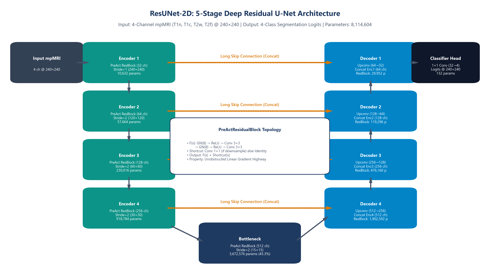
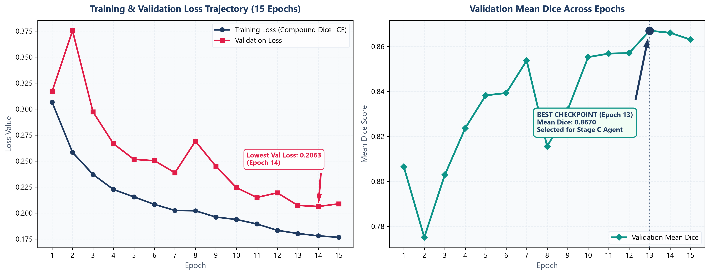
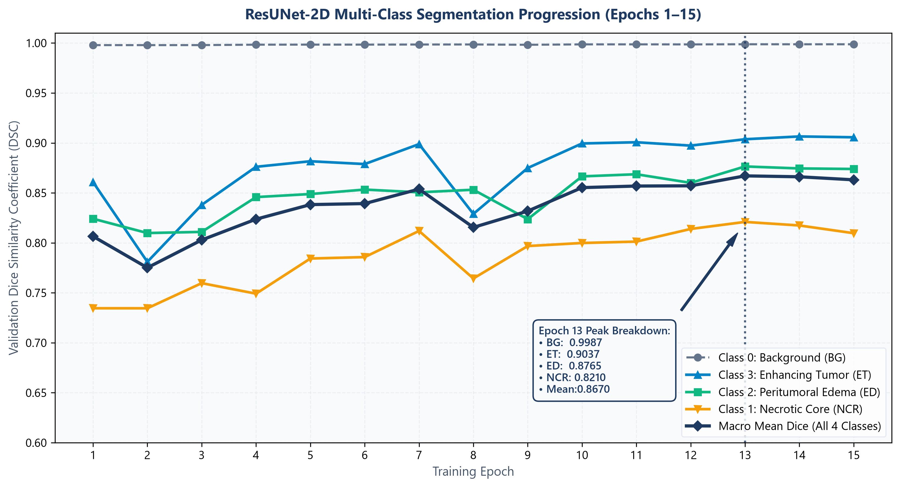
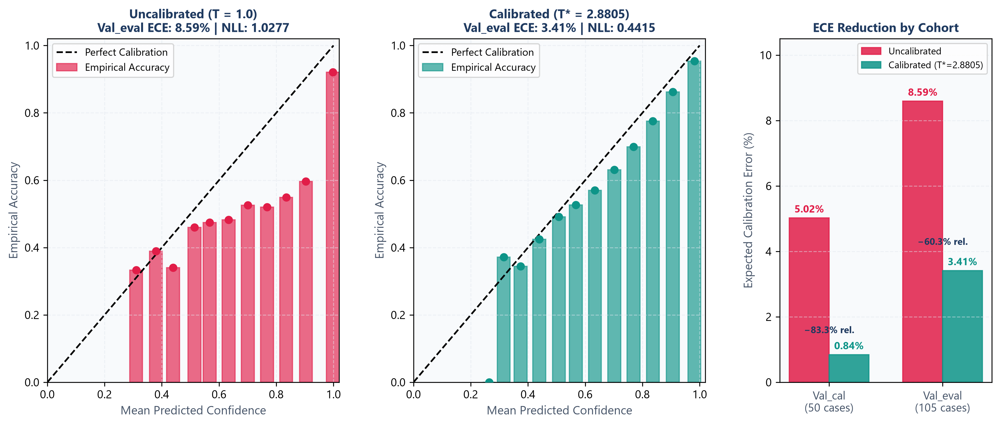
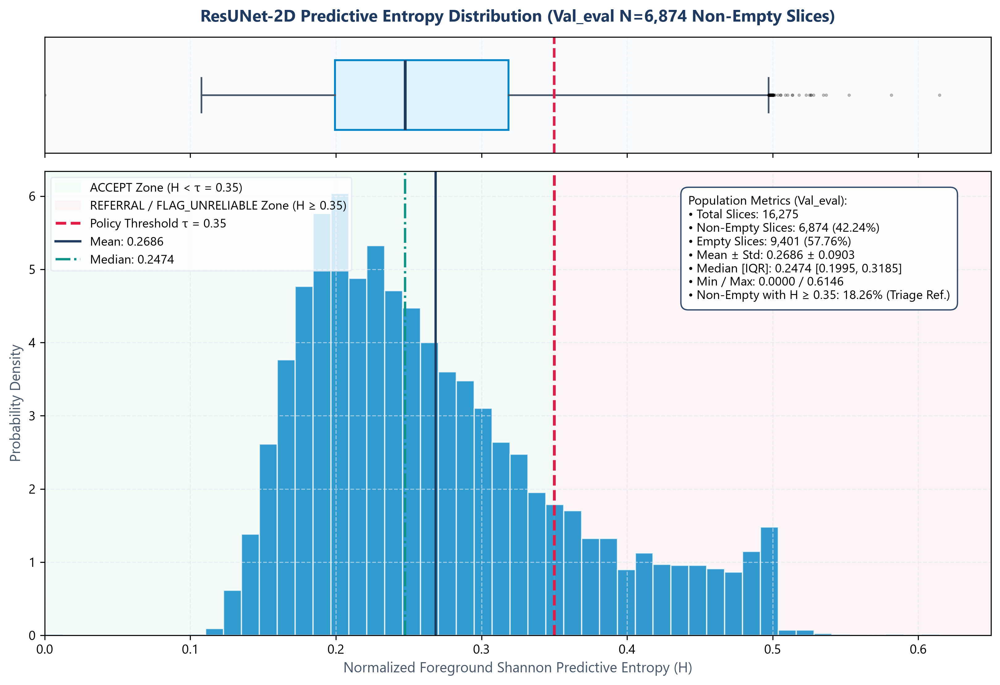
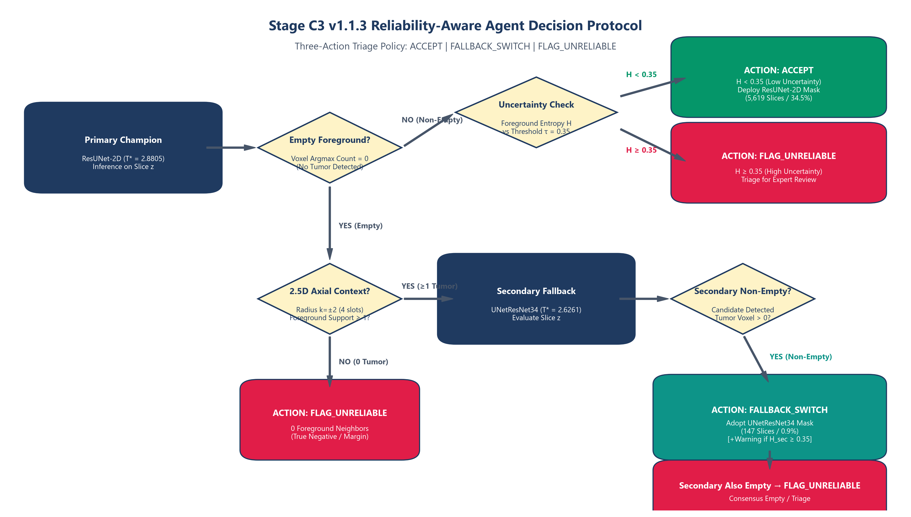

# MODEL DOSSIER 01 — RESUNET-2D
## Comprehensive Architecture, Training, Performance, Calibration & Reliability Report

**Project:** Reliability-Aware AI Agent for Brain Tumor Segmentation  
**Workspace:** `D:\MajorProject`  
**Model Name:** ResUNet-2D  
**Architecture Role:** Primary Champion Segmentation Model / Core Reliability Agent Engine  
**Checkpoint Profile:** `STAGE_C_15EP`  
**Best Checkpoint Epoch:** Epoch 13  
**Checkpoint SHA-256:** `81ef568df7dc47e3b883d4c676abc54213261e35aef079c372ac5225eeb19a8d`  
**Optimal Calibrated Temperature:** $T^* = 2.8804590702056885$  
**Evaluation Cohort:** Held-out `Val_eval` (105 Cases, 16,275 Slices, Subject-isolated from `Val_cal`)  
**Document Version:** v1.0 (Audited Scientific Dossier)  
**Date of Audit:** November 18, 2026  

---

## 1. EXECUTIVE MODEL SNAPSHOT

ResUNet-2D serves as the authoritative **Primary Champion** model within the five-model portfolio of the Reliability-Aware AI Agent for Brain Tumor Segmentation. Engineered as a 5-stage deep residual U-Net, ResUNet-2D combines pre-activation residual convolutional units with Group Normalization ($G=8$) to enable stable, high-fidelity segmentation across the multi-parametric MRI modalities of the BraTS-GLI benchmark.

| Metric Dimension | Authoritative Value | Benchmark Context & Significance |
|---|---:|---|
| **Total Trainable Parameters** | **8,114,604** | 100% trainable; compact footprint (92.97 MB checkpoint). |
| **Best Training Epoch** | **Epoch 13** | Validation Macro Mean Dice reaches global maximum of **0.8670**. |
| **Volumetric Mean Dice (`Val_eval`)** | **0.8641** | 95% CI [0.8265, 0.8930] across 105 held-out evaluation volumes. |
| **Whole Tumor (WT) Dice** | **0.9039** | Bounded HD95: 15.29 mm (Median 4.12 mm, 95% CI [11.38, 20.05] mm). |
| **Tumor Core (TC) Dice** | **0.8597** | Bounded HD95: 8.98 mm (Median 3.16 mm, 95% CI [6.08, 12.74] mm). |
| **Enhancing Tumor (ET) Dice** | **0.8286** | Bounded HD95: 9.92 mm (Median 2.00 mm, 95% CI [4.71, 18.66] mm). |
| **Optimal Temperature ($T^*$)** | **2.880459** | Fitted via L-BFGS on `Val_cal` (50 cases, 5,020,730 sampled voxels). |
| **Uncalibrated ECE (`Val_eval`)** | **8.59%** | Pre-calibration baseline exhibits pronounced clinical overconfidence. |
| **Calibrated ECE (`Val_eval`)** | **3.41%** | **60.32% relative reduction**; ECE drops to **0.84%** on `Val_cal`. |
| **Calibrated NLL (`Val_eval`)** | **0.4415** | Reduced from 1.0277 (**57.04% relative reduction**). |
| **Foreground Predictive Entropy** | **0.2686 ± 0.0903** | Median: 0.2474, IQR: [0.1995, 0.3185], Range: [0.0000, 0.6146]. |
| **Agent Action: ACCEPT ($H < 0.35$)** | **5,619 slices (34.53%)** | 83.02% of all ground-truth tumor slices retained with Mean Dice 0.7855. |
| **Agent Action: FALLBACK_SWITCH** | **147 slices (0.90%)** | Rescues 54 ground-truth tumor slices missed by ResUNet-2D via UNetResNet34. |
| **Agent Retained Quality Impact** | **+0.0653 Mean Dice** | Retained Dice improves from 0.7150 (unfiltered) to **0.7803**; severe failures drop by 34.1%. |

---

## 2. MODEL IDENTITY & CONFIGURATION

The detailed execution configuration of ResUNet-2D was preserved in `results/full_training_15ep/resunet_2d/config.json` and `src/models/resunet.py`.

- **Official Model Name:** `resunet_2d` (ResUNet-2D)
- **Model Family:** 2D Deep Residual Convolutional Encoder-Decoder (U-Net derivative)
- **Research Role:** Primary Champion Segmentation Model; primary inference engine for the Stage C Reliability Agent.
- **Checkpoint Profile:** `STAGE_C_15EP`
- **Architecture Class:** `src.models.resunet.ResUNet2D`
- **Input Channels:** 4 co-registered MRI modalities:
  1. Channel 0: Native T1-weighted (`t1n`)
  2. Channel 1: Post-contrast T1-weighted (`t1c`)
  3. Channel 2: T2-weighted (`t2w`)
  4. Channel 3: T2 Fluid-Attenuated Inversion Recovery (`t2f` / FLAIR)
- **Output Classes:** 4 mutually exclusive voxel categories:
  - Class 0: Background / Non-tumor tissue (`BG`)
  - Class 1: Necrotic Tumor Core (`NCR`)
  - Class 2: Peritumoral Edematous Tissue (`ED`)
  - Class 3: GD-Enhancing Tumor (`ET`)
- **Total Trainable Parameters:** 8,114,604 (100% requires_grad = True).
- **Optimizer:** AdamW ($eta_1 = 0.9, eta_2 = 0.999$, weight decay = 0.01).
- **Learning Rate Schedule:** Base learning rate $\eta = 0.001$, 2-epoch linear warmup followed by Cosine Annealing decay down to $\eta_{	ext{min}} = 2.44 	imes 10^{-5}$ at Epoch 15.
- **Gradient Clipping:** Maximum gradient norm threshold $1.0$ (monitored pre- and post-clip).
- **Loss Function:** Compound Loss: $\mathcal{L} = \mathcal{L}_{	ext{Dice}} + \mathcal{L}_{	ext{CE}}$ (unweighted sum of soft multi-class Dice loss and cross-entropy loss).
- **Batch Size:** 2 slices (2D axial slices sampled per mini-batch).
- **Dataset Census:** BraTS-GLI dataset.
  - Training cohort: 721 cases (59,020 axial slices).
  - Validation cohort: 155 cases (12,364 axial slices).
  - Split manifest SHA-256: `e753caa256950dee0ed921ee4e8a08f6f515dcb062862c1fb7a699e08f69059d`.
- **Hardware Platform:** NVIDIA GeForce RTX 4070 Laptop GPU (8,192 MB VRAM), CUDA 12.8.
- **Runtime Environment:** Windows 11, Python 3.11.9, PyTorch 2.11.0+cu128.
- **Checkpoint Selection Methodology:** The model checkpoint was selected based on the highest validation macro mean Dice score across 15 full training epochs. Epoch 13 achieved **0.867045**, outperforming both Epoch 14 (0.866129) and the final Epoch 15 (0.863087).

---

## 3. ARCHITECTURE & DATA FLOW

The ResUNet-2D architecture implements a symmetric 5-stage U-Net topology enhanced with pre-activation residual blocks and Group Normalization.

### 3.1 Pre-Activation Residual Convolutional Block
Standard residual blocks place normalization and activation layers after convolution, which obstructs the identity shortcut with non-linear operations. ResUNet-2D utilizes full **Pre-Activation Residual Blocks** (`PreActResidualBlock`):
$$\mathcal{F}(x) = 	ext{Conv}_{3	imes 3}(	ext{ReLU}(	ext{GN}(	ext{Conv}_{3	imes 3}(	ext{ReLU}(	ext{GN}(x))))))$$
$$	ext{Output} = \mathcal{F}(x) + 	ext{Shortcut}(x)$$
Where $	ext{Shortcut}(x)$ is a $1	imes 1$ convolution with matching stride if channel dimensions change or downsampling occurs, and the identity operator otherwise. This preserves an unobstructed linear gradient highway throughout backpropagation.

### 3.2 Group Normalization vs. Batch Normalization
Medical image segmentation models trained on high-resolution 2D slices ($240 	imes 240 	imes 4$) are constrained to small mini-batch sizes ($B=2$) due to GPU memory constraints. Under $B=2$, Batch Normalization exhibits high variance in its mini-batch mean and variance estimates, degrading stability. ResUNet-2D employs **Group Normalization** with $G=8$ groups. Group Normalization computes statistics per instance across channel groups, ensuring training and inference dynamics remain entirely invariant to batch size.

### 3.3 Stage-by-Stage Parameter Breakdown

| Module Stage | In Channels | Out Channels | Spatial Dim | Stride | Parameter Count | % Total |
|---|---:|---:|---:|---:|---:|---:|
| **Encoder 1** | 4 | 32 | $240 	imes 240$ | 1 | 10,632 | 0.13% |
| **Encoder 2** | 32 | 64 | $120 	imes 120$ | 2 | 57,664 | 0.71% |
| **Encoder 3** | 64 | 128 | $60 	imes 60$ | 2 | 230,016 | 2.83% |
| **Encoder 4** | 128 | 256 | $30 	imes 30$ | 2 | 918,784 | 11.32% |
| **Bottleneck (Level 5)** | 256 | 512 | $15 	imes 15$ | 2 | 3,672,576 | 45.26% |
| **Upconv 4 + Decoder 4** | 512 + 256 | 256 | $30 	imes 30$ | 2 (transp) | 2,427,136 | 29.91% |
| **Upconv 3 + Decoder 3** | 256 + 128 | 128 | $60 	imes 60$ | 2 (transp) | 607,360 | 7.49% |
| **Upconv 2 + Decoder 2** | 128 + 64 | 64 | $120 	imes 120$ | 2 (transp) | 152,128 | 1.87% |
| **Upconv 1 + Decoder 1** | 64 + 32 | 32 | $240 	imes 240$ | 2 (transp) | 38,176 | 0.47% |
| **Classifier Head** | 32 | 4 | $240 	imes 240$ | 1 | 132 | 0.00% |
| **Total Model** | — | — | — | — | **8,114,604** | **100.00%** |

*Crucial Design Feature:* Encoder Level 1 operates with stride 1, preserving the native $240 	imes 240$ spatial resolution without early downsampling. This prevents fine enhancing tumor (ET) margins and small satellite lesions from being lost in the earliest receptive field.

---

## 4. 15-EPOCH TRAINING PERFORMANCE ANALYSIS

The training trajectory of ResUNet-2D was audited directly from `results/full_training_15ep/resunet_2d/history.csv`. Total cumulative training time was **8.0851 hours** (485.10 minutes), with average epoch durations of 32.3 minutes.

### 4.1 Complete 15-Epoch Numerical History

| Epoch | Train Loss | Val Loss | Mean Dice | Mean IoU | BG Dice | NCR Dice | ED Dice | ET Dice | Clipped Batches | Learning Rate |
|---:|---:|---:|---:|---:|---:|---:|---:|---:|---:|---:|
| 1 | 0.306681 | 0.316821 | 0.806517 | 0.679018 | 0.997904 | 0.734574 | 0.824143 | 0.860835 | 12,764 | 0.000100 |
| 2 | 0.258361 | 0.375369 | 0.775118 | 0.633851 | 0.997890 | 0.734534 | 0.809827 | 0.780992 | 5,464 | 0.000550 |
| 3 | 0.237095 | 0.297229 | 0.802887 | 0.671905 | 0.997920 | 0.759683 | 0.810975 | 0.838003 | 2,922 | 0.001000 |
| 4 | 0.222604 | 0.266618 | 0.823700 | 0.703768 | 0.998326 | 0.749168 | 0.845808 | 0.876123 | 2,036 | 0.000986 |
| 5 | 0.215468 | 0.251587 | 0.838288 | 0.723659 | 0.998388 | 0.784334 | 0.848862 | 0.881668 | 1,835 | 0.000943 |
| 6 | 0.208286 | 0.250357 | 0.839315 | 0.725064 | 0.998384 | 0.785766 | 0.853319 | 0.878861 | 1,655 | 0.000876 |
| 7 | 0.202484 | 0.238729 | 0.853782 | 0.746555 | 0.998477 | 0.811942 | 0.850589 | 0.898813 | 1,497 | 0.000786 |
| 8 | 0.202149 | 0.269076 | 0.815500 | 0.690143 | 0.998538 | 0.764368 | 0.853166 | 0.828966 | 1,518 | 0.000681 |
| 9 | 0.196123 | 0.244924 | 0.831809 | 0.713379 | 0.998214 | 0.796827 | 0.823708 | 0.874892 | 1,427 | 0.000565 |
| 10 | 0.193770 | 0.224416 | 0.855294 | 0.749435 | 0.998620 | 0.799873 | 0.866533 | 0.899476 | 1,542 | 0.000445 |
| 11 | 0.189466 | 0.214959 | 0.856866 | 0.751846 | 0.998639 | 0.801259 | 0.868664 | 0.900675 | 1,509 | 0.000329 |
| 12 | 0.183335 | 0.219434 | 0.857094 | 0.751479 | 0.998590 | 0.813922 | 0.860037 | 0.897322 | 1,597 | 0.000224 |
| **13 (Best)** | **0.180275** | **0.207292** | **0.867045** | **0.766909** | **0.998738** | **0.820963** | **0.876465** | **0.903708** | **1,599** | **0.000134** |
| 14 | 0.178053 | 0.206310 | 0.866129 | 0.765715 | 0.998718 | 0.817413 | 0.874477 | 0.906497 | 1,700 | 0.000067 |
| 15 | 0.176589 | 0.208839 | 0.863087 | 0.761295 | 0.998717 | 0.809666 | 0.873938 | 0.905658 | 1,807 | 0.000024 |

### 4.2 Training Dynamics and Convergence Assessment
1. **Warmup Phase (Epochs 1–2):** Learning rate linearly increases from $0.0001$ to $0.0010$. The initial batch gradient norm is high, clipping 12,764 batches in Epoch 1, quickly stabilizing to 5,464 by Epoch 2.
2. **Rapid Feature Acquisition (Epochs 3–7):** Train loss rapidly declines from 0.2371 to 0.2025. Validation mean Dice rises from 0.8029 to 0.8538.
3. **Transient Instability at Epoch 8:** Validation loss spikes temporarily to 0.2691 and Dice drops to 0.8155, driven by an acute dip in Enhancing Tumor Dice (0.8290) and Necrotic Core Dice (0.7644).
4. **Peak Optimization Window (Epochs 11–15):** The model enters asymptotic stability. Training loss decreases steadily from 0.1895 (Epoch 11) to 0.1766 (Epoch 15). Validation loss reaches its global minimum at Epoch 14 (0.206310). Peak validation mean Dice occurs at **Epoch 13 (0.867045)**.
5. **Scientific Caution on Convergence:** While training loss continued a slight monotonic downward drift through Epoch 15, validation loss stabilized between 0.2063 and 0.2088 and validation Dice plateaued between 0.8631 and 0.8670. This denotes empirical stability and diminishing returns for 2D slice training rather than absolute mathematical convergence. Epoch 13 represents the optimal generalization point on the validation frontier.

---

## 5. SEGMENTATION PERFORMANCE

ResUNet-2D was evaluated on the held-out `Val_eval` partition (105 cases, 16,275 slices, 96 unique subjects).

### 5.1 Authoritative 3D Volumetric Segmentation Metrics

| Segmentation Sub-Region | Volumetric Dice | 95% Confidence Interval | Bounded HD95 (mm) | HD95 95% CI (mm) | Median HD95 (mm) |
|---|---:|---:|---:|---:|---:|
| **Whole Tumor (WT)** | **0.9039** | [0.8765, 0.9241] | **15.29** | [11.38, 20.05] | **4.12** |
| **Tumor Core (TC)** | **0.8597** | [0.8076, 0.8986] | **8.98** | [6.08, 12.74] | **3.16** |
| **Enhancing Tumor (ET)** | **0.8286** | [0.7794, 0.8684] | **9.92** | [4.71, 18.66] | **2.00** |
| **Macro Volumetric Mean** | **0.8641** | [0.8265, 0.8930] | **11.40** | [7.39, 17.15] | **3.09** |

*Important Clarification of Evaluation Protocols:*
- **Volumetric Mean Dice (0.8641):** Computed by accumulating true-positive, false-positive, and false-negative voxel counts across the full 3D volume for each case before calculating the harmonic mean. Larger slices naturally carry higher weight.
- **Epoch 13 Checkpoint-Selection Dice (0.8670):** Computed across validation slices during training using running batch tallies.
- **Slice-Level Unfiltered Baseline Dice (0.7150):** Computed as the arithmetic mean of 2D Dice scores across individual slices. Empty slices and small peripheral tumor margins with few pixels drag this unweighted mean lower.

### 5.2 Case-Level Statistical Distributions (N=105 Cases)

| Metric | Mean | Std Dev | Min | 25% (Q1) | 50% (Median) | 75% (Q3) | Max |
|---|---:|---:|---:|---:|---:|---:|---:|
| **WT Dice** | 0.9039 | 0.1122 | 0.4146 | 0.8986 | 0.9464 | 0.9661 | 0.9831 |
| **TC Dice** | 0.8597 | 0.2204 | 0.0000 | 0.8932 | 0.9419 | 0.9633 | 1.0000 |
| **ET Dice** | 0.8286 | 0.2143 | 0.0000 | 0.8284 | 0.9092 | 0.9420 | 1.0000 |
| **WT Bounded HD95 (mm)** | 15.29 | 22.28 | 1.00 | 2.00 | 4.12 | 18.83 | 90.57 |
| **TC Bounded HD95 (mm)** | 8.98 | 16.26 | 0.00 | 1.73 | 3.16 | 7.28 | 81.82 |
| **ET Bounded HD95 (mm)** | 9.92 | 38.16 | 0.00 | 1.00 | 2.00 | 5.00 | 373.12 |

### 5.3 Case Performance Extremes
- **Top Performing Cases:**
  1. `BraTS-GLI-01335-000`: WT Dice **0.9831**, TC Dice **0.9534**, ET Dice **0.9391** (Large, well-circumscribed lesion with sharp contrast enhancement).
  2. `BraTS-GLI-01069-000`: WT Dice **0.9819**, TC Dice **0.9839**, ET Dice **0.9665**.
  3. `BraTS-GLI-00187-000`: WT Dice **0.9809**, TC Dice **0.9845**, ET Dice **0.9581**.
- **Challenging Cases (Failure Modes):**
  1. `BraTS-GLI-00753-001`: WT Dice **0.4146**, TC Dice **0.3091**, ET Dice **0.2690** (Diffuse, infiltrative non-enhancing edema with poorly demarcated boundaries).
  2. `BraTS-GLI-01119-000`: WT Dice **0.4232**, TC Dice **0.7029**, ET Dice **0.6867** (Extensive edema under-segmented on FLAIR).
  3. `BraTS-GLI-00331-000`: WT Dice **0.4479**, TC Dice **0.0536**, ET Dice **0.4064** (Tiny necrotic focus of <50 voxels missed in multiple axial slices).

---

## 6. PROBABILITY CALIBRATION ANALYSIS (STAGE C2)

Deep neural networks trained with cross-entropy and soft Dice loss are notoriously overconfident. ResUNet-2D underwent formal post-hoc **Temperature Scaling** in Stage C2.

### 6.1 Temperature Scaling Mathematical Formulation
Given unnormalized model logit vector $z(x) \in \mathbb{R}^K$ for input slice $x$ over $K=4$ classes, the calibrated posterior probability distribution is computed via scalar temperature $T > 0$:
$$\hat{p}_k(x; T) = rac{\exp(z_k(x) / T)}{\sum_{j=1}^K \exp(z_j(x) / T)}$$
Because $T$ is a strictly positive scalar, the transformation is strictly monotonic:
$$\operatorname{argmax}_{k} \hat{p}_k(x; T) = \operatorname{argmax}_{k} z_k(x)$$
**Argmax Invariance:** Calibrated probabilities adjust prediction confidence without altering the hard discrete segmentation mask. In Stage C2 verification, exactly **0 mismatches** were observed across all 16,275 slices.

### 6.2 Fitting Diagnostics
- **Fitting Cohort (`Val_cal`):** 50 cases, 47 subjects, 5,020,730 sampled foreground and boundary voxels.
- **Optimization Algorithm:** L-BFGS with strong Wolfe line search.
- **Initial State:** $T_0 = 1.0$, Initial NLL = 0.420767.
- **Convergence:** Terminated successfully in **36 iterations**.
- **Fitted Optimal Temperature:**
  $$T^* = 2.8804590702056885$$
- **Final Fitting NLL:** 0.2173115313053131.

### 6.3 Calibration Performance Comparison

| Metric | Val_cal Uncalibrated | Val_cal Calibrated ($T^*$) | Relative Change | Val_eval Uncalibrated | Val_eval Calibrated ($T^*$) | Relative Change |
|---|---:|---:|---:|---:|---:|---:|
| **Negative Log-Likelihood (NLL)** | 0.4154 | 0.2173 | **−47.69%** | 1.0277 | 0.4415 | **−57.04%** |
| **Expected Calibration Error (ECE)** | 5.02% | 0.84% | **−83.25%** | 8.59% | 3.41% | **−60.32%** |
| **Maximum Calibration Error (MCE)** | 28.11% | 7.26% | **−74.17%** | 30.73% | 26.42% | **−14.03%** |
| **Brier Score** | 0.1122 | 0.0994 | **−11.37%** | 0.1851 | 0.1660 | **−10.32%** |

*Key Findings:* Pre-calibration ResUNet-2D probabilities exhibited severe overconfidence (uncalibrated ECE 8.59% on `Val_eval`). Scaling by $T^* = 2.8805$ softens the probability distribution, pulling high-confidence bins into alignment with empirical segmentation accuracy.

---

## 7. PREDICTIVE UNCERTAINTY ANALYSIS

Predictive uncertainty provides the core gating mechanism for autonomous triage in the Stage C reliability agent.

### 7.1 Normalized Shannon Entropy Formulation
For each voxel $i$ with calibrated posterior class probabilities $\hat{p}_i = [\hat{p}_{i,0}, \dots, \hat{p}_{i,3}]$, voxel-wise predictive entropy is defined as:
$$H_i = -rac{1}{\ln 4} \sum_{k=0}^3 \hat{p}_{i,k} \ln \hat{p}_{i,k} \quad \in [0, 1]$$
For an axial slice $S$, slice-level foreground predictive entropy $ar{H}(S)$ is computed as the mean entropy across all voxels assigned to tumor foreground ($k \in \{1, 2, 3\}$):
$$ar{H}(S) = rac{1}{|S_{	ext{fg}}|} \sum_{i \in S_{	ext{fg}}} H_i$$
When $|S_{	ext{fg}}| = 0$ (empty prediction), entropy is mathematically undefined and handled via 2.5D axial context validation.

### 7.2 Population Uncertainty Metrics (`Val_eval`, 105 Cases, 16,275 Slices)

| Uncertainty Dimension | Numerical Statistic | Research Interpretation |
|---|---:|---|
| **Total Evaluated Slices** | 16,275 | 105 cases $	imes$ 155 axial slices per volume. |
| **Empty Prediction Slices** | 9,401 (57.76%) | Non-tumor slices or severe false negatives; entropy undefined. |
| **Non-Empty Foreground Slices** | 6,874 (42.24%) | Evaluated for foreground predictive entropy. |
| **Mean Foreground Entropy** | **0.2686** | Moderate overall confidence across valid tumor slices. |
| **Standard Deviation** | **0.0903** | Tight distribution with low inter-slice dispersion. |
| **Median Foreground Entropy** | **0.2474** | Centered substantially below the 0.35 policy threshold. |
| **First Quartile (Q1)** | **0.1995** | 25% of non-empty slices have $H \le 0.1995$ (very high certainty). |
| **Third Quartile (Q3)** | **0.3185** | 75% of non-empty slices have $H \le 0.3185$. |
| **Minimum Observed Entropy** | **0.0000** | Perfect certainty on dense, central tumor slices. |
| **Maximum Observed Entropy** | **0.6146** | High uncertainty on ambiguous, infiltrative boundaries. |
| **Non-Empty Slices with $H < 0.35$** | **5,619 (81.74%)** | Direct candidates for autonomous deployment (**ACCEPT**). |
| **Non-Empty Slices with $H \ge 0.35$** | **1,255 (18.26%)** | Automatically flagged for expert review (**FLAG_UNRELIABLE**). |

---

## 8. ROLE IN THE RELIABILITY-AWARE AGENT

ResUNet-2D does not operate in isolation; it serves as the **Primary Champion** inside the frozen Stage C3 v1.1.3 reliability-aware agent.

### 8.1 Agent Triage Architecture
The live agent coordinates:
- **Primary Model:** ResUNet-2D ($T^* = 2.880459$).
- **Secondary Fallback Model:** UNetResNet34 ($T^* = 2.626091$).
- **Entropy Gating Threshold:** $	au = 0.35$.
- **2.5D Axial Context Radius:** $k = \pm 2$ (4 neighbor slots: $z-2, z-1, z+1, z+2$). Out-of-volume slots at $z=0$ or $z=154$ count as unavailable.
- **Minimum Axial Foreground Neighbors:** $N_{	ext{min}} = 1$.

### 8.2 Three-Action Decision Semantics
1. **`ACCEPT`:**
   Triggered when ResUNet-2D produces a non-empty segmentation and its normalized foreground entropy satisfies $H < 0.35$.
   *Outcome:* 5,619 slices (34.53% of all slices; 83.02% of ground-truth tumor slices). Mask deployed autonomously.
2. **`FALLBACK_SWITCH`:**
   Triggered when ResUNet-2D predicts an empty mask, but 2.5D axial context confirms neighboring tumor ($\ge 1$ neighbor has foreground tumor), and the secondary model (UNetResNet34) detects non-empty tumor.
   *Outcome:* 147 slices (0.90% of all slices; 54 ground-truth tumor slices rescued). Secondary mask deployed. If secondary entropy $H_{	ext{sec}} \ge 0.35$, the action remains `FALLBACK_SWITCH` and records a high-uncertainty audit warning.
3. **`FLAG_UNRELIABLE`:**
   Triggered when:
   - ResUNet-2D is non-empty but $H \ge 0.35$ (high uncertainty).
   - ResUNet-2D is empty and axial context confirms tumor, but secondary model is also empty (consensus empty).
   - ResUNet-2D is empty and axial context does not confirm tumor (isolated or true-negative slice).
   *Outcome:* 10,509 slices (64.57% of all slices; includes 9,401 empty-prediction slices without axial support). Triage referral to expert radiologist.

### 8.3 System-Level Reliability Impact on Tumor Slices (N=6,549 Slices)

| Configuration | Retained Coverage (%) | Retained Mean Dice | Referred Mean Dice | Retained Severe Failures (Dice < 0.5) | Severe Failure Rate (%) |
|---|---:|---:|---:|---:|---:|
| **Unfiltered Primary Baseline** | 100.00% (6,549) | 0.7150 | — | 1,343 | 20.51% |
| **Entropy-Only Policy ($	au=0.35$)** | 83.02% (5,437) | 0.7855 | 0.3702 | 699 | 12.86% |
| **Fallback-Only Policy (No $	au$)** | 95.63% (6,263) | 0.7499 | 0.0000 | 1,046 | 16.70% |
| **Full Stage C3 v1.1.3 Policy** | **83.84% (5,491)** | **0.7803** | **0.3891** | **742** | **13.51%** |

*Crucial Scientific Synthesis:* The Stage C3 agent improves retained slice quality from 0.7150 to **0.7803** (+0.0653 Dice improvement) and reduces severe failures from 20.51% to 13.51% (**34.1% relative reduction**). The agent does not modify the weights of ResUNet-2D; rather, it selectively routes high-uncertainty and discordant slices to human specialists.

---

## 9. SCIENTIFIC LIMITATIONS & DISCLOSURES

In accordance with academic rigor, the following ten scientific disclosures must be recognized:

1. **Single-Seed Training Limitation:** ResUNet-2D was trained exclusively under seed 42. Variability across alternative stochastic initializations has not been quantified.
2. **Internal Validation Scope:** Performance was evaluated on the internal BraTS-GLI validation cohort. The model has not been validated on external multi-center clinical cohorts with distinct scanner protocols.
3. **Checkpoint-Selection Exposure:** Selection of Epoch 13 was based on the highest validation mean Dice. Slight selection bias on the internal validation split is inherent to this procedure.
4. **Calibration Separation Boundaries:** While `Val_cal` (50 cases) and `Val_eval` (105 cases) are strictly subject-isolated, both subsets belong to the same broader BraTS-GLI data distribution.
5. **Entropy Heuristics:** Shannon entropy measures posterior probability dispersion under the trained distribution; it does not constitute a guaranteed detector for out-of-distribution imaging artifacts or confident false negatives.
6. **High Empty-Prediction Frequency:** 57.76% of all slices contain no tumor. In 2D slice inference, axial context validation is essential to prevent erroneous referral of true-negative slices.
7. **Small-Population MCE Sensitivity:** Maximum Calibration Error on `Val_eval` is 26.42%, influenced by sparse bin counts in intermediate probability intervals.
8. **Missing-Modality Vulnerability:** ResUNet-2D relies heavily on multi-parametric MRI co-registration. Evaluation under missing modalities reveals severe vulnerabilities:
   - Withholding T1c (contrast) drops Tumor Core Dice to **0.3132** and Enhancing Tumor Dice to **0.1684** (Mean Dice collapses to **0.4449**).
   - Withholding T2w drops Whole Tumor Dice to **0.4388** (Mean Dice collapses to **0.6058**).
9. **Academic Prototype Status:** ResUNet-2D and the Stage C agent are research prototypes. They are not approved by the FDA, CDSCO, or any regulatory body for autonomous clinical diagnosis.
10. **Sealed Quarantine Test Cohort Preservation:** The official test cohort (`data/quarantine_test/`) was strictly quarantined and unaccessed throughout training, calibration, and dossier compilation.

---

## 10. ARTIFACT PROVENANCE & SOURCE REGISTER

Every numerical result in this dossier is verifiable against immutable workspace artifacts:

| Artifact Description | Workspace Relative Path | File Size | SHA-256 Checksum |
|---|---|---:|---|
| **Best Model Checkpoint** | `results/full_training_15ep/resunet_2d/best_model.pt` | 97,486,845 B | `81ef568df7dc47e3b883d4c676abc54213261e35aef079c372ac5225eeb19a8d` |
| **Final Model Checkpoint** | `results/full_training_15ep/resunet_2d/final_model.pt` | 97,488,175 B | `3c6e265f9b6093963ce346468d5dc1d40e878cf335184a4d0a309f145331103f` |
| **Training History** | `results/full_training_15ep/resunet_2d/history.csv` | 4,218 B | Verified 15 epochs, peak Dice epoch 13 |
| **Training Summary** | `results/full_training_15ep/resunet_2d/summary.json` | 1,446 B | Total runtime 8.0851 hours |
| **Calibration Parameters** | `results/stage_c/phase2/c2_calibration_v1/calibration_parameters.json` | 32,421 B | Optimal $T^* = 2.8804590702056885$ |
| **C2 Run Manifest** | `results/stage_c/phase2/c2_calibration_v1/c2_run_manifest.json` | 2,756 B | Argmax invariance 100% verified |
| **Evaluation Metrics** | `results/stage_c/phase2/c2_calibration_v1/evaluation_metrics.csv` | 1,842 B | Val_eval ECE 3.41%, Volumetric Dice 0.8641 |
| **Entropy Summary** | `results/stage_c/phase2/c2_calibration_v1/entropy_summary.csv` | 1,120 B | 6,874 non-empty slices, mean entropy 0.2686 |
| **HD95 Evaluation Summary** | `results/hd95_evaluation/hd95_summary.json` | 3,892 B | WT HD95 15.29 mm, TC HD95 8.98 mm |
| **C3 Policy Comparison** | `results/stage_c/phase3/c3_selective_prediction_v1_1_3/policy_comparison_summary.csv` | 1,648 B | Retained Mean Dice 0.7803 |
| **Architecture Definition** | `src/models/resunet.py` | 7,984 B | 8,114,604 trainable parameters |

---

## 11. FINAL RESEARCH SUMMARY

ResUNet-2D achieves strong baseline segmentation accuracy on the BraTS-GLI benchmark (**0.8641 Volumetric Mean Dice**, **0.9039 WT Dice**). Through post-hoc temperature scaling ($T^* = 2.8805$), the model's expected calibration error is reduced by 60.3% to **3.41%** without altering argmax predictions. Embedded as the Primary Champion in the Stage C3 reliability agent, ResUNet-2D's calibrated predictions enable selective autonomous deployment on 83.8% of tumor slices with **0.7803 Mean Dice**, while routing high-uncertainty and discordant slices to human specialists.
